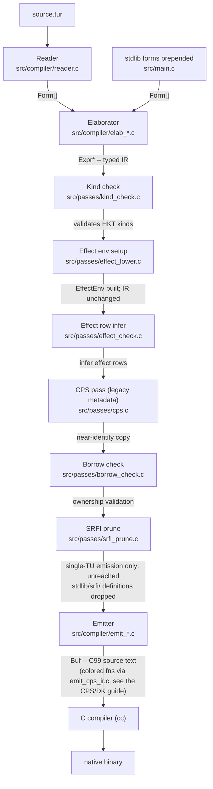

# Turmeric Compiler Internals

This guide explains how the `tur` compiler works end-to-end and what each file
in `src/` does. It is aimed at contributors who want to add a new pass, extend
the type system, or understand how source text becomes a native binary.

---

## High-level picture



All passes share a single `PassContext` (defined in `src/runtime/pass.h`) that
carries an arena allocator, a symbol table, an effect registry, a typeclass
environment, and the current program `Expr*`. The pass order is declared as a
static array in `src/main.c` and executed by `run_core_passes()`.

---

## src/ directory layout

```ascii
src/
+-- main.c              compiler driver (CLI, pass scheduling, cc invocation)
+-- compiler/           frontend: reader, elaborator, emitter, formatter
+-- passes/             analysis and transformation passes
+-- runtime/            arena, RC, GC, HAMT, STM, serializable continuations
+-- async/              fibers, scheduler, async I/O
+-- turi/               tree-walking interpreter (REPL, eval API)
+-- web/                WASM glue for the browser playground
```

---

## src/main.c

The compiler driver. Responsibilities:

- Parse global CLI flags (`--no-color`, `--dump-kinds`, `--enable=<name>`, etc.) and
  store them in `globals.c` variables before any subcommand runs.
- Dispatch subcommands: `build`, `run`, `emit-c`, `emit-h`, `check`, `format`,
  `repl`, `test`, and the Spice package manager commands (`new`, `add`, `fetch`,
  `emit-cmake`, ...).
- `compile_to_c()` -- the main compilation path. Reads the source file, loads
  the auto-loaded stdlib files (`stdlib/macros.tur`, `stdlib/contract.tur`,
  `stdlib/hamt.tur`, `stdlib/map.tur`), prepends them to the user forms, builds
  a `PassContext`, runs `run_core_passes()`, then calls `emit_program()`.
- `compile_to_h()` / `compile_to_implementation()` -- separate-compilation
  variants that emit a `.h` / `.c` pair for each module.
- `cmd_build()` -- writes generated C to a deterministic path under
  `/tmp/tur-build/` so ccache can cache repeated builds, then invokes `cc`.
- `cmd_run()` -- builds to a temp file and exec's the result. In project mode it
  reads `build.tur` (via `pkg.c`) to resolve the entry point and spice
  dependencies.

---

## src/compiler/

### reader.c / reader.h

Converts raw text into a flat array of `Form*` values. Supports four reader
modes selected by file extension or a `#lang` directive:

- `READER_TURMERIC` -- standard S-expression syntax (default for `.tur`)
- `READER_CURLY_INFIX` -- Turmeric + curly-infix (SRFI-105)
- `READER_NEOTERIC` -- Turmeric + neoteric notation
- `READER_SWEET` -- full sweet-expression syntax (`.tur.sweet`)

Key entry point: `read_all(arena, st, file, &nforms)` returns a `Form**`.

### forms.c / forms.h

Defines the `Form` union -- the raw parsed representation before type-checking:

| Kind | Description |
|------|-------------|
| `F_NIL` | `()` / nil literal |
| `F_BOOL` | boolean literal |
| `F_INT` | integer literal |
| `F_FLOAT` | float literal |
| `F_STR` | string literal |
| `F_SYM` | symbol (interned) |
| `F_KEYWORD` | `:keyword` |
| `F_LIST` | `(a b c ...)` |
| `F_VEC` | `[a b c ...]` |
| `F_MAP` | `#{k v ...}` (effect rows) |
| `F_SET` | `#s(a b ...)` set literal |
| `F_CBLOCK` | inline C block (``` ``` ```) |

Further tags cover quote/quasiquote (`F_QUOTE`, `F_QUASIQUOTE`, ...), type
annotations (`F_TYPE_ANN`, `F_CONTRACT_TYPE`), reader conditionals
(`F_READER_COND`), and the data/row literals (`F_MAP_LITERAL`,
`F_SET_LITERAL`, `F_ROW_LITERAL`).

Each `Form` also carries a `Span` (file, line, col, byte offset) used for
diagnostics.

### symbols.c / symbols.h

Symbol interning. `symtab_intern(st, slice)` returns a canonical `Symbol*`
pointer. Because symbols are interned, identity comparison (`==`) is valid
instead of `strcmp`.

### expr.c / expr.h

The typed intermediate representation (IR). Every `Expr` carries:

- `ExprKind kind` -- one of ~115 `EX_*` constants
- `Type *ty` -- the elaborated type of this expression
- `Span span` -- source location
- A union of kind-specific payload fields

Important `ExprKind` groups:

| Group | Examples |
|-------|---------|
| Literals | `EX_NIL_LIT`, `EX_BOOL_LIT`, `EX_INT_LIT`, `EX_FLOAT_LIT`, `EX_STR_LIT` |
| Variables | `EX_VAR`, `EX_GLOBAL_VAR` |
| Binding | `EX_LET`, `EX_SET`, `EX_DEF` |
| Control | `EX_IF`, `EX_DO`, `EX_WHILE`, `EX_MATCH` |
| Functions | `EX_DEFN`, `EX_FN`, `EX_CALL` |
| Types | `EX_DEFSTRUCT`, `EX_DEFDATA`, `EX_DEFGADT` |
| Effects | `EX_DEFEFFECT`, `EX_PERFORM`, `EX_HANDLE` |
| Memory | `EX_REF`, `EX_DEREF`, `EX_RC`, `EX_BORROW`, `EX_BORROW_MUT` |
| Typeclasses | `EX_DEFTYPECLASS`, `EX_DEFINSTANCE` |
| Concurrency | `EX_ASYNC`, `EX_AWAIT`, `EX_SELECT` |
| Continuations | `EX_SHIFT`, `EX_RESET` |
| Modules | `EX_DEFMODULE`, `EX_IMPORT`, `EX_EXPORT` |

`Binding` (also in expr.h) is the per-variable record attached to `let`/`def`/
`defn` forms. It tracks name, type, mutability, closure capture status, move
state (`is_moved`), and substructural annotations (linear, affine, relevant).

### types.c / types.h

The type system. `Type` has a `TypeKind` (~60 `TY_*` constants) plus
kind-specific fields.

Primitive types: `TY_UNIT`, `TY_BOOL`, `TY_INT`, `TY_I8` .. `TY_U64`,
`TY_F32`, `TY_F64`, `TY_CSTR`.

Compound types:

| TypeKind | What it represents |
|----------|--------------------|
| `TY_REF` | stack reference `&T` |
| `TY_REF_MUT` | mutable reference `&mut T` |
| `TY_RC` | reference-counted `rc<T>` |
| `TY_WEAK` | weak reference `weak<T>` |
| `TY_PTR` | raw pointer `*T` |
| `TY_STRUCT` | user-defined struct |
| `TY_ADT` | algebraic data type (sum type) |
| `TY_GADT` | generalized ADT with per-constructor types |
| `TY_UNION` | union type `(A \| B)` |
| `TY_INTERSECTION` | intersection type `(A & B)` |
| `TY_FN` | function type |
| `TY_TYVAR` | type variable (for generics, GADTs) |
| `TY_FORALL` | rank-2+ quantified type |
| `TY_EXISTS` | existential type |
| `TY_APP` | type application `F<A>` |
| `TY_CON` | type constructor |
| `TY_HANDLER` | effect handler type |

Ownership modifiers: `CopyKind` (`CK_UNIQUE`, `CK_COPY`, `CK_LINEAR`,
`CK_MULTISHOT`) and `SubstructKind` (`SK_STRUCTURAL`, `SK_AFFINE`,
`SK_RELEVANT`, `SK_LINEAR`).

`StructDef` and `AdtDef` / `CtorDef` carry the definitions of user-declared
types. `FnDef` carries a function signature with closure capture info.

### typeclass.c / typeclass.h

Typeclass registry and dictionary-passing implementation.

- `TypeClass` -- a typeclass with a list of `TypeClassMethod` entries (each has
  a name, signature, and optional default body).
- `TypeClassInstance` -- a concrete instance for a specific type, with a method
  implementation table.
- `TypeClassEnv` -- the global registry; consulted by the elaborator and emitter
  to resolve method calls and emit dictionary structs.

Typeclasses compile to static C structs (dictionaries) passed as implicit
arguments to polymorphic functions.

### elab_core.c and elab_*.c / elab.h

The elaborator transforms `Form[]` into a typed `Expr` IR. It is split into
domain-specific files:

| File | Covers |
|------|--------|
| `elab_core.c` | `let`, `if`, `do`, `while`, `begin` |
| `elab_forms.c` | Special-form dispatch and top-level routing |
| `elab_fns.c` | `defn`, `fn` (lambdas), closure capture analysis |
| `elab_call.c` | Function calls, operator overloading, method dispatch |
| `elab_types.c` | Type annotation parsing, type checking, unification |
| `elab_structs.c` | `defstruct`, field access (`.`), field mutation |
| `elab_effects.c` | `defeffect`, `perform`, `handle` |
| `elab_memory.c` | `ref`, `@` (deref), `rc/of`, `&`, `&mut`, `drop` |
| `elab_macros.c` | `defmacro`, quasiquote, macro expansion |
| `elab_typeclasses.c` | `deftypeclass`, `definstance`, method resolution |
| `elab_module.c` | `defmodule`, `import`, `export`, module file loading |
| `elab_toplevel.c` | Top-level `EX_PROGRAM` construction |
| `elab_concurrent.c` | `async`, `await`, `select`, fiber forms |
| `elab_unsafe.c` | `unsafe` blocks and unsafe operations |

The public entry point is `elaborate_program()` in `elab.h`.

### emit_core.c and emit_*.c / emit.h

Code generation from typed `Expr` IR to C99 source. Output goes into a `Buf`
(growable byte buffer).

| File | Covers |
|------|--------|
| `emit_core.c` | Header boilerplate, top-level dispatch |
| `emit_expr.c` | Literals, variables, operators, arithmetic |
| `emit_stmt.c` | `let`, `if`, `while`, `set!`, `do` |
| `emit_fns.c` | Function definitions, closure struct synthesis, thunks |
| `emit_module.c` | Per-module `.h` / `.c` split (separate compilation) |
| `emit_effects.c` | Handler literals and tables, `cont?`, the cloneable reset fallback |
| `emit_cps_ir.c` | The CPS backend: classifies colored functions and lowers their CT-IR to `f__cps(..., DK *)` |
| `emit_dk_runtime.c` | Emits the DK continuation runtime into the program preamble |

Key decisions made by the emitter:

- Closures become synthesized C structs holding captured variables, plus a
  function pointer field.
- RC retain/release calls wrap every `rc<T>` assignment and scope exit.
- Functions that can reach an effect or control operator are lowered by
  `emit_cps_ir.c` onto heap continuation chains (`DK` nodes); everything else
  is emitted direct-style. See the
  [CPS and DK internals guide](cps-dk-internals-guide.md).
- Typeclass dictionaries become `static const` C structs passed as pointers.
- Inline C blocks (```` ```c ... ``` ````) are spliced directly into the output.

Public entry points: `emit_program()`, `emit_header()`,
`emit_implementation()`.

### diag.c / diag.h

Diagnostics. `diag_error()`, `diag_warn()`, `diag_note()` emit messages with
source spans. Supports colored terminal output and JSON output
(`--json-diagnostics`). `diag_had_error()` is the pass failure sentinel.
`diag_explain()` prints a human-readable explanation for a `TUR-E####` code.

### fmt.c / fmt.h

Source code formatter (`tur format`). Parses source into `Form[]` and
pretty-prints it with configurable indent width and line width. Does not touch
the IR; operates on Forms only.

### builtins.c / builtins.h

Built-in function and operator table. Maps names to their elaborated type
signatures so the elaborator can type-check calls to `+`, `-`, `print`, etc.
without requiring a stdlib definition.

### pkg.c / pkg.h

The Spice package manager. Reads `build.tur` (project manifest) and `tur.lock`
(lock file), fetches remote spices (git clone / tar download), verifies SHA-256
integrity, generates `cmake/CMakeLists.txt` for C/CMake dependencies, and
resolves include paths for the compiler.

---

## src/passes/

These are stand-alone transformation and analysis passes that run after
elaboration. All of them receive a `PassContext*` and operate on `ctx->prog`.

### effect.c / effect.h

Effect registry. `EffectEnv` stores declared effects and their handler types.
The built-in `Unsafe` effect is registered here. Consulted by effect lowering
and the emitter.

### effect_lower.c / effect_lower.h

`PASS_EFFECT_LOWER` builds the `EffectEnv` (the builtin `Unsafe` effect and
the capabilities) and then calls `effect_lower`, which returns the program
unchanged. Despite the name and the header comment, `EX_PERFORM`/`EX_HANDLE`/
`EX_RESUME` survive to the CPS backend, which lowers them directly; they are
**not** rewritten to `shift`/`reset`.

### effect_check.c / effect_check.h

Infers and validates effect rows per function (Phase P19-2): registers the
`defeffect`s, resolves unresolved rows (TUR-E0026) and populates per-`defn`
effect row annotations that can be dumped with `--dump-effects`.

### kind_check.c / kind_check.h

Validates kind annotations on type expressions (Phase HKT H0). Ensures that
type constructors are applied to the correct number and kind of arguments.
`--dump-kinds` prints the annotated IR after this pass.

### cps.c / cps.h

Home of the **coloring** analysis (`cps_color_program`): which functions can
dynamically reach a control operator and so must be CPS-lowered. The backend
runs it at emission time, not from this pass. `PASS_CPS` itself runs the CPS
dumps and `cps_transform`, which today is a near-identity tree copy that
records legacy metadata (`may_capture`, the cloneable clone plan dumped by
`--dump-clone-plan`).

### cps_ir.c / cps_ir.h

The CT-IR: an A-normal-form IR with explicit continuations, produced for each
colored function by `cps_ir_translate_fn` and consumed by
`src/compiler/emit_cps_ir.c`. `--dump-cps` prints it. The
[CPS and DK internals guide](cps-dk-internals-guide.md) covers this, the
coloring, the emitted ABI and the DK runtime end to end.

### borrow_check.c / borrow_check.h

Ownership, move, and borrow analysis (Phase 14). Validates that:

- Moved values are not used after a move.
- Borrowed references do not outlive the owned value.
- Mutable borrows are exclusive.
- Linear values are consumed exactly once.
- Effect handler case bodies do not capture borrow-typed variables from the
  enclosing scope.

### lifetimes.c / lifetime_elision.c

Lifetime annotation parsing and automatic lifetime elision (similar to Rust's
rules). These are utilities used by the borrow checker.

### srfi_prune.c / srfi_prune.h

Drops each top-level definition from a `stdlib/srfi/` file that nothing
outside those files reaches, transitively, so an `#lang r7rs` program pays only
for the SRFI procedures it uses (r7rs-srfi-plan S3). `compile_to_c` calls it
on the final program just before `emit_program`; it is not in the
`run_core_passes` list, because separate compilation and REPL sessions must keep
every definition. The walk lists every expression kind and gives up (pruning
nothing) on one it does not recognize, so a new `ExprKind` needs an arm there
-- `-Wswitch` points at it.

### rc_elision.c / rc_elision.h

Eliminates redundant RC retain/release pairs via static analysis (Phase 9+).
An RC increment immediately followed by a decrement on the same value is
removed. This runs transparently during elaboration of RC forms.

---

## src/runtime/

### arena.c / arena.h

Bump allocator. `arena_alloc(arena, size)` returns memory from a growing slab.
`arena_free()` releases the entire arena at once. Most per-compilation-unit
allocations use the arena so that cleanup is a single free rather than tracking
individual pointers.

### buf.c / buf.h

Growable byte buffer used for code generation output and string construction.
`buf_printf()`, `buf_puts()`, `buf_write()`, `buf_to_file()`.

### rc.c / rc.h

Reference-counting runtime for `rc<T>` values. Provides `rc_retain()`,
`rc_release()`, and drop hook registration. Thread-safe variant: `arc.c` /
`arc.h` (atomic RC, future).

### gc.c / gc.h

Bacon-Rajan cycle collector layered on top of RC. Detects reference cycles that
would otherwise leak (Phase 10). Runs as a background sweep.

### rc_free_queue.c / rc_free_queue.h

Deferred RC deallocation queue. Objects whose RC drops to zero are queued here
and freed at a safe point rather than inline in the decrement, which avoids
deep recursion during large tree teardowns.

### hamt.c / hamt.h

Persistent Hash Array Mapped Trie -- the data structure backing `hamt<K,V>` and
`map<K,V>` in Turmeric. Structural sharing makes `insert`, `remove`, and
`lookup` O(log32 n) with no mutation of existing nodes.

### interp.c / interp.h

Compile-time macro interpreter. Evaluates macro bodies (tree-walking) at
elaboration time so that macros can expand to arbitrary `Form` trees. Shares
some evaluation logic with `turi/eval.c` but is simpler and does not support
async.

### serial.c / serial.h

Serializable continuations (Phase 21). Allows a continuation to be captured,
serialized to bytes, transferred (e.g. over a network), and resumed on another
node. Used by the web continuations feature.

### stm.c / stm.h

Software Transactional Memory (Phase 20). Implements `retry`, `or-else`, and
transactional variables (`TVar`). Integrates with the fiber scheduler for
blocking retry.

### globals.c / globals.h

Global compiler-configuration variables set by CLI flags:
`g_dump_kinds`, `g_strict_effects`, `g_linear_enabled`, `g_gadt_enabled`,
`g_panic_abort`, etc. Declared `extern` and included by any file that needs
them.

### pass.h

Defines `PassKind` (the ordered enum of compiler passes) and `PassContext` (the
shared state struct threaded through every pass). See the pipeline section above.

### platform.h

Platform-detection macros and thin wrappers for OS differences (macOS vs.
Linux). Included by async and runtime code.

---

## src/async/

Fiber-based async runtime.

### fiber.c / fiber.h

Lightweight cooperative fibers (user-level threads). Each fiber has a small
stack and a saved register context. `fiber_spawn()`, `fiber_yield()`,
`fiber_resume()`.

### fiber_ctx_arm64.S / fiber_ctx_x64.S

Architecture-specific context switch assembly. Saves and restores
callee-saved registers and the stack pointer. One file is compiled per target
architecture.

### scheduler.c / scheduler.h

The fiber scheduler, including the multi-threaded work-stealing variant
(each OS thread has a local deque; idle threads steal from the tail of a
peer's deque).

### io.c / io_kqueue.c / io_epoll.c

Async I/O abstraction. `io.c` defines the platform-neutral API; `io_kqueue.c`
is the macOS/BSD backend, `io_epoll.c` the Linux backend, and `io_iocp.c` the
Windows backend. Integrates with
the scheduler so that I/O-blocked fibers are automatically rescheduled when the
underlying fd is ready.

### timer_wheel.c / timer_wheel.h

Hierarchical timer wheel for efficient timer management. Timers are stored in
slots; a tick advances the wheel and fires expired timers without scanning all
pending timers.

### atomic_queue.c / atomic_queue.h

Lock-free work queue used by the work-stealing scheduler for inter-thread
task handoff.

---

## src/turi/

Tree-walking interpreter for the REPL and the `eval` API.

### eval.c / eval.h

Main evaluation loop. Takes an `Expr*` and an `Env*` and returns a `Value*`.
Supports the full language including closures, ADTs, effects (interpreted),
and async (via the fiber runtime).

### env.c / env.h

Lexical environment: a linked list of frames, each mapping `Symbol*` to
`Value*`. `env_extend()` creates a child frame; `env_lookup()` walks the chain.
Macros are stored in a separate macro namespace within the env.

### value.c / value.h

Runtime value representation for the interpreter:

| ValueKind | Represents |
|-----------|-----------|
| `VAL_NIL` | unit |
| `VAL_BOOL` | boolean |
| `VAL_INT` | 64-bit integer |
| `VAL_FLOAT` | 64-bit float |
| `VAL_STR` | heap string |
| `VAL_CLOSURE` | function + captured env |
| `VAL_ADT` | algebraic data type instance |
| `VAL_STRUCT` | struct instance |
| `VAL_CONTINUATION` | captured continuation |
| `VAL_FIBER` | live fiber handle |

### repl.c / repl.h

Interactive REPL (Phase S1). Uses `libedit` for line editing, history, and
multi-line input. Supports meta-commands: `:type expr`, `:doc name`,
`:reload file`. Entry point: `turi_repl_run()`.

### fiber.c / fiber.h (turi/)

Fiber integration for the interpreter. Bridges `turi/eval.c` with
`src/async/fiber.c` so that `async`/`await` forms work in the REPL.

---

## src/web/

WASM glue code. `wasm_glue.c` exports `turi_wasm_eval()`, `turi_doc_lookup()`,
and the other `turi_wasm_*` entry points to JavaScript. `turi_doc_lookup` is
called by the doc panel in the web REPL (`web/`) when the user hovers over a
name.

---

## Data flow summary

The pass chain and the value each stage hands the next are drawn once, in
[High-level picture](#high-level-picture). This section used to redraw them,
and the two copies drifted -- the duplicate had never picked up the SRFI prune
pass, and the original had never picked up the stdlib-prepend edge. One diagram
now carries both.

All allocations within a compilation unit live in a single `Arena` that is
freed as one block at the end of `compile_to_c()`. The symbol table owns
interned symbol strings; everything else is arena-allocated.

---

## Adding a new compiler pass

1. Add a `PASS_YOUR_PASS` constant to `PassKind` in `src/runtime/pass.h` at
   the position in the pipeline where it should run.
2. Create `src/passes/your_pass.c` and `your_pass.h`. The pass function should
   accept a `PassContext*` and return `0` on success, `1` on failure (after
   emitting diagnostics via `diag_error()`).
3. Add a `case PASS_YOUR_PASS:` to `run_core_passes()` in `src/main.c`.
4. Add `your_pass.c` to the CMake target in `CMakeLists.txt`.

The `kind_verify_program()` assertion runs in debug builds after every pass to
ensure kind annotations are preserved. New passes that rewrite the IR must
propagate kind info from source nodes to replacement nodes.

---

## Adding a new built-in type or operator

1. Add a `TY_*` constant to `TypeKind` in `src/compiler/types.h` and a
   corresponding creation function in `types.c`.
2. Register the operator name and its type signature in `src/compiler/builtins.c`.
3. Add an elaboration case in the appropriate `elab_*.c` file.
4. Add code generation in `emit_expr.c` or `emit_stmt.c`.

---

## Further reading

- `docs/guides/effects-system-guide.md` -- algebraic effects in depth
- `docs/guides/hkt-guide.md` -- higher-kinded types
- `docs/guides/substructural-types-guide.md` -- linear, affine, relevant types
- `docs/guides/module-system-guide.md` -- separate compilation
- `docs/design/` -- architectural decision and rationale notes
