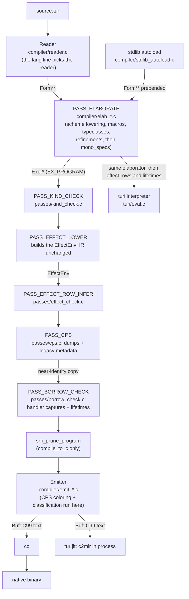

# Turmeric Compiler Internals

This guide is the map. It explains how source text becomes a native binary,
which pass does what, where every subsystem lives in `src/`, and which guide
covers each one in depth. Start here, then follow the "Deep dive" links.

> **Trust the code over the header comments.** Many file and function
> comments in `src/` predate later consolidations. `pass.h` says
> `PASS_EFFECT_LOWER` turns `perform`/`handle` into `shift`/`reset`; it
> does not. `core_passes[]` calls `PASS_EFFECT_ROW_INFER` a "stub slot"; it
> is a full checker. Where a comment and this guide disagree, read the code.
> If the code disagrees with this guide, fix the guide.

---

## The short version

1. **One front end, two back ends.** The reader turns text into `Form`s.
   The elaborator turns forms into one typed `EX_PROGRAM` tree. The compiled
   path emits C99 from that tree; the interpreter (`turi`) walks the same
   tree directly.
2. **Six core passes**, listed in `src/driver/pipeline.c:core_passes[]`: elaborate,
   kind check, effect env, effect rows, CPS (legacy metadata), borrow and
   lifetime checks. Most of the real checking happens inside elaboration.
3. **The emitter makes more decisions than the passes do.** CPS coloring and
   classification, ABI specialization, drop insertion and the runtime
   preamble are all decided while emitting.
4. **The runtime is mostly text the emitter writes** into every program. A
   few real `.c` runtime files are linked from archives or pasted in.
5. **`cc` (or the MIR JIT) finishes the job.** `tur build` writes the C to a
   stable temp path and runs one `cc`; `tur jit` compiles it in process.

---

## High-level picture



The passes share one `PassContext` (`src/runtime/pass.h`): the `arena` and
symbol table `st` for the whole compile, the input `forms` (the first
`stdlib_prefix` of them are autoloaded stdlib), the `tc_env` typeclass
registry, the program `prog`, the `effect_env` (`NULL` until
`PASS_EFFECT_LOWER`), and module-lookup settings (`module_base_dir`,
`include_dirs`, `separate_compilation`, `reader_macros`).

**Compiler data lives in one arena per compile.** `compile_to_c` creates an
`Arena` and a `SymbolTable`, allocates every `Form`, `Expr`, `Binding` and
most types in it, and frees both at the end. Symbols are interned, so
`Symbol*` compares with `==`. Function types' per-argument arrays live in a
separate process-lifetime arena in `types.c`. Process-global tables (the
diagnostic state, the emitter's signature and spec tables, the CPS cache)
are reset per compile or emission, because `tur test <dir>`, project builds,
`tur lsp` and `tur mcp` compile many programs in one process.

---

## The pass schedule

`run_core_passes` (`src/driver/pipeline.c`) walks `core_passes[]` and calls
`run_core_pass` for each, charging the time to its `--timings` zone
(`pass_zone`). A pass returns 0 to continue, 1 to fail, or 2 to stop
successfully (only `tur audit-spans` does that). In builds without `NDEBUG`
each arm also asserts `kind_verify_program`.

| Pass | Function(s) | What it really does |
|---|---|---|
| `PASS_ELABORATE` | `elaborate_program` (`elab_toplevel.c`), then `mono_specs_resolve_program` | Forms to typed IR. Inside it: `(load ...)` splicing, `#lang r7rs` lowering, macro expansion, typeclass resolution, move/linear checks and refinement discharge. After it, in the same arm: lens spec resolution, `--dump-mono-specs`, and `tur audit-spans`' `span_audit_program` |
| `PASS_KIND_CHECK` | `kind_check_pass` | Top-level only: infers class parameter kinds from instances, checks instance type arguments and GADT return types (TUR-E0012), and runs an occurs check on `defrec`. Most kind errors are caught earlier, in the elaborator. `--dump-kinds` |
| `PASS_EFFECT_LOWER` | `effect_env_new`, `effect_env_register_builtin_unsafe`, `effect_env_register_builtin_capabilities`, `effect_lower` | Builds the `EffectEnv`. `effect_lower` returns its input unchanged; effects are **not** rewritten to `shift`/`reset` |
| `PASS_EFFECT_ROW_INFER` | `effect_check_pass` | Registers `defeffect`s, resolves declared rows (TUR-E0026), infers every function's row by whole-program fixpoint, checks declared against inferred. `--dump-effects` |
| `PASS_CPS` | `cps_dump_coloring`, `cps_ir_dump_program`, `cps_transform`, `cps_dump_clone_plan` | The CPS dumps, then `cps_transform`: a near-identity tree copy recording **legacy** metadata. The coloring the backend uses is computed later, by the emitter |
| `PASS_BORROW_CHECK` | `borrow_check_program`, `borrow_check_effect_handler_captures`, `lifetime_check_program` | `borrow_check_program` returns at once: `borrow_check_enabled` defaults to false and nothing calls `borrow_check_set_enabled`. The two always-on checks reject a handler case that captures an outer borrow, and run lifetime elision plus the outlives-cycle check |

**After the list**, `compile_to_c` (whole-program builds only) runs:

1. `resolve_rcgc_from_archive` -- whether the preamble defines the rc/GC
   runtime or only declares it for `libturt_runtime.a`.
2. `srfi_prune_program` -- drops unreached `stdlib/srfi/` definitions. It is
   not a core pass because separate compilation and REPL sessions must keep
   every definition.
3. The optional `#lang r7rs` library/client split (`emit_split.c`).
4. `emit_program`, inside which CPS coloring and classification run (see
   [CPS: coloring and the CT-IR](#cps-coloring-and-the-ct-ir)).
5. `emit_exports_manifest`, only when the REPL's in-process spice build has
   set a manifest sink. `--shared` project builds write theirs from
   `compile_to_implementation`.

`compile_to_h` and `compile_to_implementation` run the same six passes and
then `emit_header` / `emit_implementation`. **The interpreter runs a
subset:** `turi_eval_impl` (`src/turi/eval.c`) calls
`elaborate_program_session`, `effect_check_pass` and
`lifetime_check_program`, and never `PASS_CPS`, the handler-capture check or
the emitter. **`tur check` emits C:** it calls `compile_to_c` with a
throwaway buffer, so an emission-time error is still a `check` error.

Deep dive: [build-driver-internals-guide.md](build-driver-internals-guide.md).

---

## src/ layout

```ascii
src/
+-- main.c            the entry point: big-stack trampoline, the dispatcher
+-- driver/           the rest of the driver, one file per area: flags and the
|                     command table (cli.c), compile_to_c/_h/_impl (pipeline.c),
|                     cc invocation, tur jit, project builds, the subcommands
+-- jit_engine.c/.h   in-process MIR JIT engine (TUR_JIT builds only)
+-- platform_*.h      Windows shims: dl, fs, mman, proc, ucontext over Fibers
+-- jit_win_prelude.h, source_literal.h, tur_argcheck.h   small helpers
+-- compiler/         front end, elaborator, emitter, and tools that share them
|   +-- reader.c reader_macros.c lang_dialects.c forms.c symbols.c
|   +-- stdlib_autoload.c scheme_lower.c
|   +-- elab.h elab_internal.h elab_*.c (18 files)
|   +-- expr.c/.h types.c/.h typeclass.c/.h builtins.c/.h
|   +-- mono_specs.c refine_*.c (10 files) trail_c.h
|   +-- emit.h emit_internal.h emit_*.c (9 files)
|   +-- mangle.c stack_guard.c jit_prune.c
|   +-- diag.c/.h span_audit.c prof.c
|   +-- pkg.c spice_search.c global.c install.c justrun.c
|   +-- fmt.c project.c r7rs_bignum.inc r7rs_numsyntax.inc
+-- passes/           kind_check effect effect_lower effect_check cps cps_ir
|                     borrow_check lifetimes lifetime_elision rc_elision srfi_prune
+-- runtime/          compiler infrastructure and the host-side runtime
|   +-- arena.c buf.c globals.c experiments.c pass.h platform.h
|   +-- rc.c arc.c gc.c rc_free_queue.c rt_alloc.c region.c r7gc.c
|   +-- hamt.c tur_string.c symbols.c trail.c contract_handler.c
|   +-- tur_tls.c tur_atomics.c ffi_dispatch*.c image.c sha256.c serial.c
|   +-- generated/    tur_rt_split.c tur_rt_split_decls.h tur_rt_split_embed.c
|   +-- (not built)   runtime.c stm.c cps_prompt.c
|   +-- (dead)        interp.c cps_rt.c
+-- async/            fibers, the reactor, I/O backends
|   +-- fiber.c fiber_ctx_{x64,arm64,x64_win}.S reactor.c io.c
|   +-- io_epoll.c io_kqueue.c io_iocp.c atomic_queue.c tur_sjlj_x64_win.S
|   +-- (not built)   scheduler.c timer_wheel.c
+-- turi/             tree-walking interpreter, REPL, macro-time env, debugger
+-- lsp/              tur lsp (lsp*.c) and tur mcp (mcp.c)
+-- cli/              tur completion, tur demangle, tur lsp-lite
+-- web/              wasm_glue.c, wasm_lsp.c (playground), tutorial.c
```

**Build targets** (`src/CMakeLists.txt`):

| Target | What it is |
|---|---|
| `tur_core` | OBJECT library: every source in `TUR_CORE_SOURCES`, shared by `tur`, `libturi` and many unit tests |
| `tur` | `main.c` + `driver/*.c` (`TUR_DRIVER_SOURCES`) + `lsp/mcp.c` + `tur_core` (+ `tur_jit_obj` under `TUR_JIT`) |
| `libturi.a` | `tur_core` as a static library, for C embedders and programs that autolink `-lturi` |
| `libturt_runtime.a` | a lean, unsanitized archive of the runtime TUs programs link (`hamt`, `rc`, `gc`, `region`, ...) |
| `libturt_preamble.a` | the generated preamble runtime (`tur_rt_split.c`), linked by `--runtime=split` |
| `tur_jit_obj` | `jit_engine.c` + `turi/jit_ffi.c`, kept out of `tur_core` so MIR does not reach its other consumers |

A new `.c` file joins `TUR_CORE_SOURCES` in `src/CMakeLists.txt`, not the
top-level `CMakeLists.txt`. The subsystem directories (except `turi/`) are
on the include path, so `#include "arena.h"` works from anywhere.

---

## Driver: src/main.c and src/driver/

`main` (`src/main.c`) moves onto a large stack (`tur_run_on_big_stack`) and
calls `tur_main_inner`. That parses global flags into `g_*` variables
through the `GLOBAL_FLAGS[]` table, resolves the subcommand (exact name,
alias or unique prefix) in the `COMMANDS[]` table, and calls its handler;
both tables are in `src/driver/cli.c`. The compile entry points are
`compile_to_c` (one C unit) and `compile_to_h` / `compile_to_implementation`
(separate compilation), in `driver/pipeline.c`. `cmd_build_once` writes the C
to `$TMPDIR/tur-build/` (a stable name, so ccache hits), picks how the
runtime is linked, and runs one `cc`. `tur run <file>` builds to a temp
executable and runs it. Project builds (`cmd_build_project`,
`cmd_build_multi_files`) and `tur jit` (`cmd_jit`) have files of their own in
`src/driver/`.

Deep dive: [build-driver-internals-guide.md](build-driver-internals-guide.md).

---

## Reader: forms, symbols, dialects

`read_all` / `read_all_with_registry` (`reader.c`) turn a `SourceFile` into
a `Form**`. `Form` (`forms.h`) is the raw syntax tree: atoms (`F_NIL`,
`F_BOOL`, `F_INT`, `F_FLOAT`, `F_STR`, `F_SYM`, `F_KEYWORD`), collections
(`F_LIST`, `F_VEC`, `F_MAP`, `F_SET`), `F_CBLOCK` (an inline C block), the
quote family (`F_QUOTE`, `F_QUASIQUOTE`, `F_UNQUOTE`, `F_UNQUOTE_SPLICING`),
`F_TYPE_ANN`, `F_CONTRACT_TYPE`, `F_READER_COND`, `F_RANGE_VAR`, and the
data literals `F_MAP_LITERAL`, `F_SET_LITERAL`, `F_ROW_LITERAL`. Each form
carries a `Span`: file id, line, and column and byte-offset ranges.

The `#lang` line picks a pair: a `ReaderType` (`READER_TURMERIC`,
`READER_CURLY_INFIX`, `READER_NEOTERIC`, `READER_SWEET`, `READER_R7RS`,
`READER_R7RS_SWEET`) and a `LangDialect` (`LANG_TURMERIC`, `LANG_SAFFRON`,
`LANG_R7RS`). Both enums live in `diag.h`. `lang_dialects.c` owns the table
of legal bases (`lang_base_lookup`); `driver/paths.c:detect_and_adjust_lang` strips
the line. Sweet-expressions are a preprocessing step inside `reader.c` that
records a `SweetMap`, so diagnostics point at the original text.
`reader_macros.c` holds the `#`-dispatch registry: the builtins
(`reader_macros_install_builtins`) and user `reader-macros/define` forms.
User-facing reference: [reader-forms-guide.md](reader-forms-guide.md).

**Stdlib autoload.** Before elaboration, `tur_stdlib_prepend_forms`
(`stdlib_autoload.c`) reads and prepends `autoload_files_[]`: 34 files
today -- `macros`, `safe`, `contract`, `hamt`, eleven `typeclass-*` stubs,
`char`, the collections (`map`, `vec`, `slice`, `set`, `mutmap`, `grid`,
`zipper`), `option`, `result`, `pair`, `tuple`, `list`, `json`, `schema`,
`sym`, `unique`, `trail` and `region`. A language prelude
(`g_lang_prelude`, e.g. R7RS's) is appended last. Project mode loads the same
list through `driver/pipeline.c:load_project_prelude`, via the shared accessor
`tur_stdlib_autoload_files`. `tur check --no-auto-stdlib` matters only when
the checked file is itself on the list: that file and the ones after it are
skipped, so it can be checked alone.

**Scheme lowering.** `scheme_lower_program` (`scheme_lower.c`) rewrites the
R7RS core forms (`define`, `lambda`, named `let`, `do`, `cond`, `case`,
`define-values`, ...) into Turmeric forms, `Form` to `Form`, for forms whose
file is `LANG_R7RS`. The elaborator calls it after `(load ...)` splicing,
for the entry program (`elab_toplevel.c`) and for imported modules
(`elab_module.c`). Deep dive:
[r7rs-implementation-guide.md](r7rs-implementation-guide.md).

---

## Elaborator: src/compiler/elab_*.c

`elaborate_program` (a wrapper over `elaborate_program_session`,
`elab_toplevel.c`) takes the whole form array and returns one
`EX_PROGRAM`, or `NULL` after any error. It splices loads, lowers Scheme,
folds loose top-level statements into a synthesized `main`, forward-declares
every `defn` (pass 1), then elaborates each form (pass 2). `elab_form`
dispatches on the `Form` tag; a list goes to `elab_call`, which tries special
forms, then macros, then bindings, then typeclass methods, and only then the
builtin operator table. Type inference is call-site-local. Lambdas are
lifted into file-scope `EX_FN_DEF`s as they are elaborated.

| File | Covers |
|---|---|
| `elab_toplevel.c` | `elaborate_program_session`, `elab_form`, the main fold, pass 1 and the pass-2 retry/deferral machinery |
| `elab_call.c` | `elab_call`/`elab_call_inner` (special-form, macro and call dispatch), the ordinary call path, type-variable binding, partial application |
| `elab_core.c` | the `Elab` state, scopes, `binding_new`, move and linear state, `collect_free_vars` |
| `elab_forms.c` | control-flow forms: `let`, `let*`, `letrec`, `if`, `do`, `while`, `case`, `set!`, `defer`, `return` |
| `elab_fns.c` | `defn`, `fn` (lifting and closures), `def`, `extern-c`, ownership masks, contracts, loop invariants |
| `elab_types.c` | type-expression forms: `type_expr_from_form`, `defkind`, `defrec`, `deftype`, `type-app`, ascription, `pack`/`open` |
| `elab_structs.c` | `defstruct` (lowered to a record `defdata`), `defopaque`, `defdata`, `defgadt`, `match`, `make-struct` |
| `elab_typeclasses.c` | `defclass`, `definstance`, method dispatch |
| `elab_effects.c` | `reset`/`shift`/`shift0`, cloneable and serial continuations, `call/cc`, `defeffect`, `perform`, `handle`, `resume` |
| `elab_macros.c` | `defmacro`, `defmacro*`, quasiquote, the compile-time evaluator |
| `elab_module.c` | `load`, `import`, `defmodule`, `export`, qualified-name lookup |
| `elab_memory.c` | `ref`, `lref`, `@`, `drop!`, `rc`/`weak`, GC primitives |
| `elab_concurrent.c` | `thread-spawn`, `async`/`await`, `select`, panics, STM |
| `elab_unsafe.c` | `unsafe`, pointer operations, casts, raw memory, `dlopen` |
| `elab_dynvars.c` | `defdynamic`, `binding` (dynamic vars) |
| `elab_sessions.c` | session-type channel operations |
| `elab_global.c` | multi-party protocols (`defprotocol`); projection is in `project.c` |
| `elab_reflect.c` | the `^reflect` totality gate (`reflected-measures` experiment) |

There is no separate macro-expansion pass: `elab_call_inner` expands a macro
call in place. `defmacro` templates are substituted and, if needed, run
through `elab_macros.c`'s small evaluator (`ct_eval_form`); `defmacro*`
bodies run in a capability-denied, fuel-limited turi env
(`elab_macro_env_get`, implemented in `src/turi/macro_env.c`). Refinement
obligations are created and discharged here too (from `elab_fns.c` and
`elab_call.c`; see [Refinement solver](#refinement-solver)), and
`mono_specs.c` collects the lens specializations that
`mono_specs_resolve_program` resolves right after.

Deep dive: [elaborator-internals-guide.md](elaborator-internals-guide.md).

### The IR: expr.h

Every node is a `struct Expr`: `ExprKind kind`, `Type type` (by value, not a
pointer), `Span span`, a few drop-hint flags, and a union payload. There are
120 `EX_*` kinds:

| Group | Kinds |
|---|---|
| Literals | `EX_NIL_LIT`, `EX_BOOL_LIT`, `EX_INT_LIT`, `EX_FLOAT_LIT`, `EX_CSTR_LIT`, `EX_SYM_LIT`, `EX_SET_LIT`, `EX_CONS_LIST` |
| Binding | `EX_VAR`, `EX_LET`, `EX_LETREC`, `EX_SET`, `EX_DEF` |
| Control | `EX_IF`, `EX_DO`, `EX_WHILE`, `EX_MATCH`, `EX_RETURN`, `EX_DEFER` |
| Functions | `EX_FN_DEF`, `EX_FN`, `EX_CLOSURE`, `EX_CALL`, `EX_BUILTIN`, `EX_EXTERN_C`, `EX_INLINE_C`, `EX_POLY_WRAP`, `EX_FN_TO_FAT`, `EX_POLY_TO_FAT` |
| Data | `EX_DEFDATA`, `EX_DEFGADT`, `EX_MAKE_STRUCT`, `EX_GET_FIELD`, `EX_SET_FIELD`, `EX_UNION_INJECT`, `EX_DEFAULT_OF` |
| Memory | `EX_REF`, `EX_DEREF`, `EX_SET_DEREF`, `EX_REF_PRED`, `EX_RC_OF`, `EX_RC_CLONE`, `EX_RC_DROP`, `EX_RC_PTR`, `EX_RC_COUNT`, `EX_RC_FROM_REF`, `EX_REF_FROM_RC`, `EX_WEAK`, `EX_WEAK_UPGRADE`, `EX_WEAK_PRED`, `EX_BORROW_IMMUT`, `EX_BORROW_MUT` |
| Casts and `any` | `EX_CAST`, `EX_REINTERPRET`, `EX_ASCRIBE`, `EX_EXISTS_PACK`, `EX_EXISTS_OPEN`, `EX_EXISTS_DISPATCH`, `EX_ANY_TYPE_OF`, `EX_ANY_CAST`, `EX_ANY_IS` |
| Typeclasses | `EX_TYPECLASS_DEF`, `EX_INSTANCE_DEF`, `EX_DICT` |
| Control operators | `EX_RESET`, `EX_SHIFT`, `EX_SHIFT0`, `EX_CALLCC`, `EX_CLONEABLE_RESET`, `EX_CLONEABLE_SHIFT`, `EX_SERIAL_RESET`, `EX_SERIAL_SHIFT`, `EX_CPS_CONT_APP`, `EX_CONT_PRED` |
| Effects | `EX_DEFECT` (`defeffect`), `EX_PERFORM`, `EX_HANDLE`, `EX_HANDLER_LIT`, `EX_WITH_HANDLER`, `EX_COMPOSE_HANDLERS`, `EX_RESUME`, `EX_DISCONTINUE` |
| Panics | `EX_PANIC`, `EX_PANIC_WITH`, `EX_CATCH_UNWIND`, `EX_CATCH_PANIC_OF`, `EX_PANIC_PAYLOAD_{TYPE,VALUE,FILE,LINE,DOWNS}` |
| Concurrency, STM | `EX_ASYNC`, `EX_AWAIT`, `EX_SELECT`, `EX_STM`, `EX_ATOMICALLY`, `EX_RETRY`, `EX_CHECK`, `EX_OR_ELSE`, `EX_TVAR_{NEW,READ,WRITE,MODIFY,SWAP,CAS}` |
| Generators | `EX_GEN`, `EX_YIELD`, `EX_GEN_NEXT`, `EX_GEN_DONE`, `EX_GEN_UNWRAP` |
| Dynamic (Saffron, r7rs) | `EX_DYN_OP`, `EX_DYN_CALL`, `EX_DYN_FIELD`, `EX_DYN_METHOD`, `EX_DEFDYNAMIC`, `EX_DYNVAR_READ`, `EX_DYNVAR_BINDING`, `EX_DYNVAR_SET` |
| Structure | `EX_PROGRAM`, `EX_DEFMODULE` |

There is no `EX_DEFSTRUCT` (a `defstruct` lowers to `EX_DEFDATA`), no
import/export node (modules resolve during elaboration), and no
`EX_STR_LIT`/`EX_GLOBAL_VAR` (a global is an `EX_VAR` whose binding has
`is_global`).

`Binding` is the per-name record shared by every reference: name, type,
mutability, `is_global`/`is_param`, move state (`is_moved`, `moved_at`),
substructural flags (`is_linear`, `is_affine`, `is_relevant`, `is_unique`),
closure and continuation facts, and module export data. `FnDef` is a
function definition: binding, parameters, `return_type`, body, closure info,
and analysis results such as `cps_colored` and `inferred_effect_row`.

### Types: types.h

`Type` is a by-value struct: `TypeKind kind`, `CopyKind copy_kind`,
`SubstructKind substruct`, lifetimes, `Kind hkt_kind`, and a union payload.
There are 61 `TY_*` kinds:

| Group | Kinds |
|---|---|
| Scalars | `TY_NIL` (unit/void), `TY_BOOL`, `TY_INT` (`int64_t`), `TY_FLOAT` (`double`), `TY_INT8`..`TY_INT64`, `TY_UINT8`..`TY_UINT64`, `TY_FLOAT32`, `TY_FLOAT64`, `TY_CSTR`, `TY_SYM`, `TY_PTR_VOID` |
| Ownership | `TY_REF` (owning `ref<T>`), `TY_LREF` (linear `lref<T>`), `TY_RC`, `TY_WEAK`, `TY_REF_IMMUT` (`&T`), `TY_REF_MUT` (`&mut T`) |
| User data | `TY_ADT` (every `defdata`, `defgadt`, `defstruct` and `defopaque`; a GADT is an `AdtDef` with `is_gadt`), `TY_APP`, `TY_REC`, `TY_TYVAR` |
| Functions, control | `TY_FN`, `TY_CONT`, `TY_CLONEABLE_CONT`, `TY_HANDLER`, `TY_GENERATOR`, `TY_EXCEPTION` |
| Polymorphism, gradual | `TY_FORALL`, `TY_EXISTS`, `TY_UNION`, `TY_INTERSECTION`, `TY_ANY`, `TY_NEVER`, `TY_CONTRACT` |
| Typeclasses | `TY_TYPECLASS`, `TY_TYPECLASS_INST` |
| Sessions | `TY_SESSION`, `TY_SEND`, `TY_RECV`, `TY_CLOSE`, `TY_CHOOSE`, `TY_BRANCH`, `TY_SESSION_REC`, `TY_TIMEOUT`, `TY_SESSION_PAIR`, `TY_SESSION_RECV_PAIR`, `TY_SESSION_OFFER`, `TY_GLOBAL`, `TY_ROLE` |
| Other | `TY_SET`, `TY_UNKNOWN`, `TY_DYNVAR`, `TY_TYPEROW`, `TY_SYNTAX`, `TY_STRUCT` |

`TY_STRUCT` is never a `Type.kind` any more: `StructDef` was deleted, and the
constant survives only as the `any`-box reflection tag that `type-of`
reports as "struct". `AdtDef`/`CtorDef` describe user types. `CopyKind` is
`CK_UNIQUE` (alias `CK_MOVE`), `CK_COPY`, `CK_UNSIZED`, `CK_LINEAR`,
`CK_MULTISHOT`; `SubstructKind` is `SK_STRUCTURAL`, `SK_AFFINE`,
`SK_RELEVANT`, `SK_LINEAR`. The C spelling, mangle token and layout of each
payload-free kind come from one table, `TY_SIMPLE_REPR_ROWS` in `types.c`.

### Typeclasses

`typeclass.c` is the registry: `TypeClass`, `TypeClassMethod`,
`TypeClassInstance`, `TypeClassEnv` (one per compile, in
`PassContext.tc_env`). Resolution happens in `elab_typeclasses.c`: a
resolved method call is a direct `EX_CALL` to the instance method, with an
`EX_DICT` annotation. Constrained generics are monomorphized by default.
Every live instance still emits `__inst_*` functions and a
`dict_<Class>_<T>` struct with a singleton, but a dictionary is passed at
run time only where monomorphization cannot reach, such as a rank-2 use.

Deep dive: [typeclass-internals-guide.md](typeclass-internals-guide.md).

### Built-in operators: builtins.c

`table_[]` in `builtins.c` maps operator names (`+`, `println`, `ptr-deref`,
...) to arity, argument and result types, a `BuiltinShape` that says how to
print the C, and an optional effect name (`"IO"`). `builtin_lookup` picks the
first row matching the name, the first argument's type and the arity. The
result is an `EX_BUILTIN`; `emit_core.c:emit_builtin` and `turi/eval.c` both
switch on its shape.

---

## Analyses inside and after elaboration

### Refinement solver

`refine_collect.c` turns each refinement crossing point into a normalized
verification condition (`refine_vc.c`). `refine_discharge.c` runs the staged
in-house solver (`refine_solver*.c`: syntactic S0, congruence closure S1,
linear arithmetic S2, Nelson-Oppen S3) and memoizes results. A proven
obligation drops its runtime check in `emit_fns.c`; any other outcome keeps
it. `refine_smtlib.c` writes VCs as SMT-LIB2 for debugging and parses
SMT-LIB2 scripts for `tur smt`. There is no SMT dependency in any build.

Deep dive: [refinement-solver-internals-guide.md](refinement-solver-internals-guide.md).

### Effects and effect rows

`effect.c` holds the data model: `Effect`, `EffectRow`, `EffectEnv`, and the
row algebra. The elaborator parses `#fx{...}` into unresolved rows and does
scope- and arity-based effect checks (TUR-E0008 and friends).
`PASS_EFFECT_LOWER` builds the env with `Unsafe` and the compiler-known
capabilities; `effect_lower` itself is a no-op. `PASS_EFFECT_ROW_INFER`
(`effect_check.c:effect_check_pass`) resolves, infers and checks rows; CPS
coloring, the CT-IR translator and the emitter read the results
(`FnDef.inferred_effect_row`).

Deep dive: [effect-rows-internals-guide.md](effect-rows-internals-guide.md).
User-facing: [effects-system-guide.md](effects-system-guide.md).

### CPS: coloring and the CT-IR

There is one lowering for effects and delimited control on the compiled
path: functions that can reach a control operator are emitted in
continuation-passing style over a heap chain of `DK` nodes. Everything else
is plain direct-style C.

**cps.c / cps.h.** Home of the **coloring** analysis (`cps_color_program`):
which functions can dynamically reach a control operator and so must be
CPS-lowered. The backend runs it at emission time, not from this pass.
Function bodies are emitted before the preamble is generated, so the first
query is `emit_cps_ir_try_fn`, which `emit_fn_def_body` calls for the first
function the item loop emits. That call runs `ensure_S`: it colors the tree
being emitted, classifies the colored functions into the set `S` the backend
can lower, and caches the result keyed on the program and `EmitCtx`
addresses. Later queries, including the preamble gate
`emit_cps_ir_program_has_emittable`, read the cache. `emit_cps_ir_forget`
clears it at the start and end of every top-level emission.

`PASS_CPS` itself runs the CPS dumps and `cps_transform`, which today is a
near-identity tree copy that records legacy metadata (`may_capture`,
`is_cps`, the cloneable `live_captures` plan dumped by `--dump-clone-plan`).
Only the opt-in `--cps-path` wrappers and the dumps read that metadata. The
returned tree does replace `ctx->prog`, and its `source_fn_def` retargeting
is relied on, so the pass cannot simply be deleted. `cps.c` also exports
`cps_visit_children`, the one shared enumeration of an expression's
evaluated operands; the coloring and the effect checker fall back to it.

**cps_ir.c / cps_ir.h.** The CT-IR: an A-normal-form IR with explicit
continuations, produced for each colored function by `cps_ir_translate_fn`
and consumed by `src/compiler/emit_cps_ir.c`. Effects reach it as
`EX_PERFORM`/`EX_HANDLE`/`EX_RESUME`, which it turns into
`CT_PERFORM`/`CT_HANDLE`/`CT_RESUME` directly. `--dump-cps` prints it.

Deep dive: [cps-dk-internals-guide.md](cps-dk-internals-guide.md) covers
the coloring, the CT-IR, the emitted ABI and the DK runtime end to end.

### Borrows and lifetimes

Moves, linear and affine use, and uniqueness are checked **in the
elaborator** (`elab_core.c`, `binding_mark_moved` and friends), because they
need scope state that is gone afterwards. `PASS_BORROW_CHECK` adds two
always-on checks: `borrow_check_effect_handler_captures` (a handler case
body cannot read an outer borrow) and `lifetime_check_program`, which uses
`lifetimes.c` (the outlives graph) and `lifetime_elision.c` (Rust-like
elision rules). The general walker, `borrow_check_program`, is disabled.
User-facing: [borrow-checking-and-lifetimes-guide.md](borrow-checking-and-lifetimes-guide.md).

### SRFI pruning

`srfi_prune_program` (`srfi_prune.c`) drops each top-level definition from a
`stdlib/srfi/` file that nothing outside those files reaches, transitively,
so an `#lang r7rs` program pays only for the SRFI procedures it uses.
`compile_to_c` calls it just before emission. The walk lists every
expression kind and gives up (pruning nothing) on one it does not
recognize, so a new `ExprKind` needs an arm there; `-Wswitch` points at it.

---

## Emitter: src/compiler/emit_*.c

`emit_program(Buf *out, const Expr *program)` writes one C99 translation
unit. It runs on a big stack, scans first (the ABI scan decides which
generic calls need a per-type clone), then emits into many buffers that are
assembled at the end. `emit_value(ctx, body, e)` appends the statements an
expression needs and returns a C expression string; `emit_stmt` emits for
effect. Every non-void call is hoisted into a temp followed by a
`tur_panicking` check, which is how panics unwind. The runtime preamble is
generated after every body but written first.

| File | Covers |
|---|---|
| `emit_module.c` | `emit_program` and `emit_program_inner`, `emit_header`/`emit_implementation`, the ABI scan (`emit_abi_*`), forward declarations, ADT typedefs and constructors, the runtime preamble (`emit_runtime_preamble`), `emit_rt_split_source` |
| `emit_expr.c` | `emit_value` and the expression switch, including the call arm |
| `emit_core.c` | shared helpers: temps, naming, atoms, `emit_builtin`, `inline_c_substitute`, include hoisting, escape analyses |
| `emit_fns.c` | `emit_fn_def`/`emit_fn_def_body`, tail calls and mutual tail-call groups, the catch-unwind splitter |
| `emit_stmt.c` | `emit_stmt`, `while`, `set!`, field and deref stores |
| `emit_effects.c` | expression arms for `reset`/`shift`/`handle`/`resume` and handler values when the direct emitter reaches them |
| `emit_cps_ir.c` | the CPS backend: classification (`ensure_S`) and CT-IR to `f__cps(..., DK *)` (`emit_cps_ir_try_fn`) |
| `emit_dk_runtime.c` | string emitters for the DK machine, `call/cc`, the cloneable bridge and the serial marshaler |
| `emit_split.c` | the text transform behind the `#lang r7rs` library/client split |

Related helpers: `mangle.c` (name mangling), `stack_guard.c`
(`tur_run_on_big_stack`, stack headroom), `jit_prune.c` (drops unreached
static C before c2mir sees it), and `passes/rc_elision.c`, whose
`rc_elision_analyze_fn` is called from `emit_fns.c` (`emit_fn_def_body`,
`tcg_emit_def`) to drop redundant `rc` clone/drop pairs just before a body
is emitted.

Deep dives: [emitter-architecture-guide.md](emitter-architecture-guide.md)
(the value/statement contract, phase order, output bands, ABI
specializations);
[emitted-code-ownership-guide.md](emitted-code-ownership-guide.md) (who
frees what);
[value-representations-guide.md](value-representations-guide.md) (the C
representation of each kind of value and the boundaries between them);
[type-erasure-guide.md](type-erasure-guide.md) (where types collapse to
`int64_t`); [monomorphization-abi-guide.md](monomorphization-abi-guide.md)
(`__spec_*` clones and the by-value ABI);
[name-mangling-guide.md](name-mangling-guide.md) (source names to C
identifiers).

### Runtime preamble and linkage

Most of the runtime is C text that `emit_runtime_preamble` writes at the top
of every program, gated by whole-program scans and `g_needs_*` flags. In
single-file mode the runtime is `static` in the program. In separate
compilation one owner TU defines it. In archive posture the rc/GC and region
runtime are only declared and `libturt_runtime.a` supplies them. The S2
split (`tools/gen-runtime-split.py`) commits one canonical emission to
`src/runtime/generated/`: `tur_rt_split.c` replaces the host's old
`runtime.c`, `cps_prompt.c`, `stm.c`, `scheduler.c` and `timer_wheel.c` in
`tur_core`, and backs `libturt_preamble.a`.

Deep dive: [runtime-preamble-and-linkage-guide.md](runtime-preamble-and-linkage-guide.md).

### Regions

Regions (RM3) are on by default (`TUR_REGIONS=0` turns them off). A call to
`with-region` or `bt-scope` is bracketed by the emitter with a push and a
pop of an arena generation (`src/runtime/region.c`). The pop rewinds only
when a static walk of the result type and the runtime escape note both
agree that nothing points in. Every store that can outlive a bracket must
note the word it writes; that is the CLAUDE.md "Region Store Hooks" rule.

Deep dive: [regions-internals-guide.md](regions-internals-guide.md).

### Separate compilation

`compile_to_h` and `compile_to_implementation` emit a `.h`/`.c` pair per
module (`emit_header`, `emit_implementation`). Each TU carries its own copy
of the stdlib prelude, and the emitter treats `is_from_stdlib` bindings
specially so a multi-TU link sees no duplicate symbols.
`cmd_build_multi_files` (`driver/project.c`) runs two passes so cross-module
borrow-spec clones are forced into their owning module, then writes a
runtime owner TU and links.

Deep dive: [separate-compilation-internals-guide.md](separate-compilation-internals-guide.md).

---

## Runtime code: src/runtime/ and src/async/

| File | Role |
|---|---|
| `arena.c` | bump allocator (`arena_alloc`, `arena_free`, `arena_reset`, `arena_owns`); the compiler's main allocator and the region generations |
| `buf.c` | growable byte buffer for all generated text (`buf_puts`, `buf_printf`, `buf_to_file`) |
| `globals.c` | most global flags (`g_strict_effects`, `g_dump_effects`, `g_cps_path`, `g_opt_regions`, `g_lang_prelude`, ...); a few, like `g_dump_kinds`, live in `src/driver/` and are declared in `driver/driver.h` |
| `experiments.c` | the `EXPERIMENTS[]` registry behind `--enable=<name>` and `tur experiments`; `experiment_warn_if_used` |
| `rc.c`, `arc.c` | `rc<T>`/`weak<T>` control blocks (`rc_strong_increment`, `rc_strong_decrement`, `rc_upgrade`); atomic variant |
| `gc.c`, `rc_free_queue.c` | Bacon-Rajan cycle collector over `rc` (`gc_collect`; in auto mode also at allocation checkpoints, `gc_on_alloc_checkpoint`; no background thread); deferred frees |
| `rt_alloc.c` | the runtime archive's allocator hook |
| `region.c`, `r7gc.c` | region generations; the conservative collector of compiled `#lang r7rs` programs. The emitter pastes their source into programs from `region_rt_embed.c`, which the build generates from these files (`build/src/generated/`); `region.c` is also in `libturt_runtime.a` |
| `hamt.c`, `tur_string.c`, `symbols.c`, `trail.c` | persistent maps, owned strings, the runtime symbol table, the backtracking trail -- linked from `libturt_runtime.a` or compiled beside a program via `__tur_autolink__` |
| `contract_handler.c` | the contract-violation handler registry programs call by extern |
| `tur_tls.c`, `tur_atomics.c` | thread-local state and atomics for front ends without them (the JIT) |
| `ffi_dispatch.c`, `ffi_dispatch_thunk.c` | generated FFI trampolines (`tools/gen_ffi_dispatch.py`) for the interpreter |
| `image.c`, `serial.c` | the application-image header codec; the host copy of the TSER continuation wire format (only the fuzzer calls it; programs get theirs from `emit_dk_runtime.c`) |

Deep dive for memory management: [gc-guide.md](gc-guide.md).

**src/async/.** `fiber.c` provides cooperative stacks (`tur_fiber_new`,
`tur_fiber_resume`, `tur_fiber_yield`, `tur_fiber_done`, `tur_fiber_free`)
over the hand-written context switch `tur_ctx_swap` in `fiber_ctx_*.S`.
`reactor.c` is the evented I/O reactor (`tur_reactor_*`) behind
`stdlib/reactor.tur`; programs that use it autolink `-lturi`. `io.c` is the
backend interface (`async_io.h`), with `io_epoll.c` (Linux), `io_kqueue.c`
(macOS/BSD) and `io_iocp.c` (Windows; despite its name, a `select()`
backend). `tur_sjlj_x64_win.S` is the DK trampoline's landing pad on
Windows. Compiled programs get their async/await scheduler, STM and timers
from the emitted preamble, not from this directory. Deep dive:
[reactor-guide.md](reactor-guide.md).

### Code that is not on any live path

Several files look important and are not. Do not extend them; check before
deleting, since some are kept for a unit test.

| File | Status |
|---|---|
| `src/runtime/interp.c` | An old Form-to-Form macro interpreter. Compiled into `tur_core`, but nothing calls it. The real macro evaluators are `elab_macros.c` and `turi/macro_env.c` |
| `src/runtime/cps_rt.c` | The CPS4 `TurKont` trampoline. In `tur_core`, used only by `tests/cps_rt_unit.c` |
| `src/runtime/cps_prompt.c` | The original reference DK machine; built only into the `tur_cps_prompt_unit` test. The emitted machine has diverged far from it |
| `src/runtime/runtime.c`, `stm.c`, `src/async/scheduler.c`, `timer_wheel.c` | Replaced by `generated/tur_rt_split.c`; built by no target |
| `src/async/atomic_queue.c` | Built, but its only consumer is the unbuilt `scheduler.c` |
| `src/passes/effect_lower.c` | Returns its input unchanged |
| `borrow_check_program` | Disabled (see [Borrows and lifetimes](#borrows-and-lifetimes)) |

---

## The other engines: turi and the JIT

### Interpreter: src/turi/

`turi_eval_impl` (`eval.c`) parses, elaborates with the same elaborator,
runs the effect-row and lifetime checks, and then walks the `Expr` tree
with an explicit-stack CEK-style machine (`eval_drive_ex`). Values are a
16-byte tagged union, `TuriValue` (`TURI_*` tags, `value.h`), passed by
value. All interpreter state lives in `TuriEnv` (`env.h`): globals in a hash
table, locals in a chain of `EvalFrame`s looked up by name. Stdlib functions
with inline-C bodies are replaced by C natives (`interpreter_natives.c`,
`collections_native.c`, `string_native.c`).

Other files: `repl.c` (`tur repl`), `preload.c` (the shared stdlib preload),
`macro_env.c` (the macro-time env), `fiber.c` (the interpreter's own
ucontext scheduler, futures and timers -- it does not use `src/async/`),
`dap.c` and `trace.c` (debugger and time-travel recorder), `spice_loader.c`
and `ffi_thunk.c` (REPL spice images), `jit_ffi.c`, `jit_ffi_hook.c` and
`inline_c_jit.c` (c2mir-backed FFI and inline C), `r7rs_embed.c` (R7RS
`eval`), `docstrings.c`.

Deep dive: [turi-interpreter-internals-guide.md](turi-interpreter-internals-guide.md).

### JIT: jit_engine.c

Under `-DTUR_JIT=ON` (the default on 64-bit x86-64 and arm64), `tur jit`
compiles the emitted C in process through MIR's c2mir front end
(`external/mir/`, vendored). `cmd_jit` in `driver/jit.c` drives it; `jit_prune.c`
trims the C first; the S2 split lets it swap the preamble for precompiled
declarations. A program the JIT cannot handle falls back to `cc`.

Deep dive: [jit-guide.md](jit-guide.md).

---

## Supporting subsystems

### Diagnostics: diag.c / diag.h

`diag_emit(level, span, fmt, ...)` reports a message. The variants are
`diag_emit_with_code` (a `DiagCode` such as `TUR_E0012_KIND_MISMATCH`),
`diag_emit_with_notes`, `diag_emit_with_suggestion` and
`diag_emit_multi_span`. `diag_had_error()` is the failure sentinel every
pass checks; `diag_reset()` clears it per compile. Output is a colored
terminal snippet, JSON (`--json-diagnostics`, `diag_emit_json`), or an LSP
capture (`diag_lsp_begin`/`diag_lsp_flush`). `diag_explain(code, out)` looks
up `tur explain` text in the `diag_explanations_[]` table. `diag.c` also
owns the source-file registry (`diag_register_file`) that maps a span's
file id to text.

Deep dive: [diagnostics-internals-guide.md](diagnostics-internals-guide.md).

### Package manager: pkg.c and friends

`pkg.c` reads `build.tur` / `build.tur.sweet` (`pkg_manifest_read`), reads
and writes `tur.lock` (`pkg_lock_read`, `pkg_lock_write`), fetches spices
(`pkg_git_fetch`, `pkg_fetch_all`), and generates `cmake/CMakeLists.txt` for
`:cmake-deps` (`pkg_gen_cmake_deps`). `spice_search.c` computes the module
search path for a file inside a spice. `global.c` and `install.c` implement
`tur install` and friends; `justrun.c` is the Justfile runner behind
`tur run <recipe>`.

Deep dive: [package-manager-internals-guide.md](package-manager-internals-guide.md).

### Editor tooling, CLI helpers and the web build

- **`src/lsp/`** -- `tur lsp`: `lsp.c` (handlers and dispatch), `lsp_io.c`
  (framing), `lsp_collect.c` and `lsp_scope.c` (symbol and scope tables,
  filled by hooks in `compile_to_c`), `lsp_docs.c`, `lsp_json.c`,
  `lsp_util.c`, `lsp_session.c`/`lsp_sink.c` (one dispatch, two
  transports). `mcp.c` is `tur mcp`, linked into `tur` only. See
  [lsp-guide.md](lsp-guide.md).
- **`src/cli/`** -- `completion.c` (`tur completion`), `demangle.c`
  (`tur demangle`), `lsp_lite.c` (`tur lsp-lite`, newline-delimited JSON).
- **`src/web/`** -- `wasm_glue.c` exports the `turi_wasm_*` API and
  `turi_doc_lookup` to the playground's JavaScript; `wasm_lsp.c` runs the
  LSP analysis in the browser (and natively under the
  `tur_lsp_wasm_backend_unit` test); `tutorial.c` is the REPL tutorial
  engine. The WASM build is `tur run wasm` (CMake `-DTUR_WASM=ON`).
- **Other tools** -- `fmt.c` (`tur format`/`tur fmt`, works on `Form`s
  only), `span_audit.c` (`tur audit-spans`), `prof.c` (`--timings`).

---

## Adding a new compiler pass

1. Add a `PASS_YOUR_PASS` constant to `PassKind` in `src/runtime/pass.h`
   and update the order in its header comment.
2. Add it to `core_passes[]` in `src/driver/pipeline.c`, at the position where it
   should run.
3. Add a `case PASS_YOUR_PASS:` to `run_core_pass` in the same file. Return
   1 on failure after reporting with `diag_emit` / `diag_emit_with_code`;
   check `diag_had_error()` if you call code that reports without returning
   a status. If the pass rewrites the IR, add the `kind_verify_program`
   assertion under `#ifndef NDEBUG` like the other arms, and propagate kind
   information onto replacement nodes.
4. Give it a `--timings` zone: a `PROF_*` value in `src/compiler/prof.h`
   (in pipeline order), its name in `k_zone_names[]` in `prof.c`, and a case
   in `pass_zone` (`driver/pipeline.c`). `pass_zone` has no `default:` arm, so
   `-Wswitch` under `-Werror` fails the build until you do.
5. Put the code in `src/passes/your_pass.c` / `.h` and add the `.c` to
   `TUR_CORE_SOURCES` in `src/CMakeLists.txt`.
6. Handle every `ExprKind` your walk can meet. Most IR switches have a
   `default:` arm, so the C compiler will not list the kinds for you; reuse
   `cps_visit_children` for operand enumeration where you can. The
   elaborator guide's checklist lists the existing walkers.
7. Decide whether the interpreter needs it too. `turi_eval_impl` in
   `src/turi/eval.c` runs its own subset of passes and will not pick a new
   one up from `core_passes[]`.
8. Reset any file-scope state at the start of each run: one process
   compiles many programs (see [High-level picture](#high-level-picture)).

Before adding a pass, check whether the work belongs in the elaborator
(it needs scope state) or the emitter (it needs to know what was printed).
Most recent analyses landed in one of those two.

---

## Adding a new built-in operator or type

**An operator over existing types:**

1. Add a row to `table_[]` in `src/compiler/builtins.c`: name, minimum and
   maximum arity (`-1` = variadic), argument type, result type, a
   `BuiltinShape`, the C operator or function name, and the effect name if
   it does I/O. The first matching row wins, so put specific rows first.
2. If an existing shape fits (`BS_BIN_INFIX`, `BS_VARIADIC_FOLD`,
   `BS_PREFIX_UNARY`, `BS_FUNC_CALL`, ...), nothing else is needed:
   `elab_call_inner` falls through to `builtin_lookup` and builds an
   `EX_BUILTIN`. A binding of the same name (for example a stdlib `defn`)
   takes precedence over the table.
3. A new shape needs a `BuiltinShape` value in `builtins.h`, an arm in
   `emit_core.c:emit_builtin`, and an arm in the interpreter's switch over
   `spec->shape` in `src/turi/eval.c`.
4. Add a fixture under `tests/fixtures/`, and run it under
   `tur interpret` too.

**A new `TypeKind`:**

1. Add the `TY_*` constant to `TypeKind` in `src/compiler/types.h`.
2. Answer the three representation questions. For a payload-free kind, add
   one row to `TY_SIMPLE_REPR_ROWS` in `types.c` (C name, mangle token,
   concrete layout); otherwise add arms to `type_c_name`,
   `append_type_mangle` and `type_has_concrete_codegen_layout`. Those
   switches have no `default:`, so `-Wswitch` finds them.
   `tests/check-typekind-mangle-exhaustive.sh` re-checks the table.
3. Add a case to `typekind_default_copy_kind` in `types.h`. It **has** a
   `default:` that returns `CK_MOVE`, so forgetting it makes the type
   silently move-only.
4. Handle it in `type_eq` and `type_print` (`types.c`), and add a `TYPE_*`
   convenience macro next to `TYPE_INT` if it is a simple kind.
5. Make it spellable: `typekind_from_symbol` (`elab_core.c`) for a bare
   name, `type_expr_from_form` (`elab_types.c`) for a parameterized one.
6. Find the switches that need an arm by grepping for a neighbouring kind
   (`grep -rn 'case TY_SYM' src/` hits the elaborator, the emitter and
   `turi/eval.c`). If values of the type exist at run time, read
   [value-representations-guide.md](value-representations-guide.md) first.

---

## Debugging the pipeline

| Flag or command | Shows |
|---|---|
| `tur emit-c f.tur` | the generated C |
| `tur expand f.tur` | macro expansions, while checking |
| `--timings` | time per zone (read, elaborate, typeclass, refine, emit, cc, ...) |
| `--dump-kinds`, `--dump-effects` | kinds after `PASS_KIND_CHECK`; each `defn`'s inferred effect row |
| `--dump-cps-coloring`, `--dump-cps`, `--dump-clone-plan` | CPS coloring, the CT-IR, the cloneable capture plan |
| `--dump-mono-specs`, `--emit-abi-trace` | the lens spec registry; the ABI path chosen per call site |
| `tur audit-spans f.tur` | IR nodes missing a breakpoint span |
| `tur explain TUR-E####` | the long text for a diagnostic code |
| `TUR_SHOW_CC=1` | the `cc` command and split-build decisions |

There is no general IR dump; `expr_print` (`expr.c`) exists but nothing
calls it, so call it from a debugger. More techniques are in
[diagnosing-the-compiler-guide.md](diagnosing-the-compiler-guide.md) and
[debugging-guide.md](debugging-guide.md).

---

## Further reading

- [effects-system-guide.md](effects-system-guide.md) -- algebraic effects
- [hkt-guide.md](hkt-guide.md) -- higher-kinded types
- [substructural-types-guide.md](substructural-types-guide.md) -- linear,
  affine and relevant types
- [module-system-guide.md](module-system-guide.md) -- modules and imports
- [experimental-flags-guide.md](experimental-flags-guide.md) -- the
  `--enable=<name>` lifecycle
- `docs/archive/` -- design plans and resolved reports
