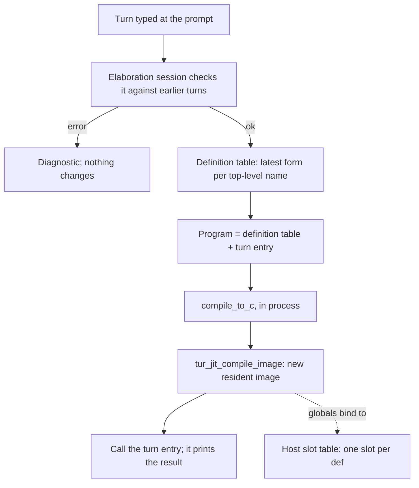
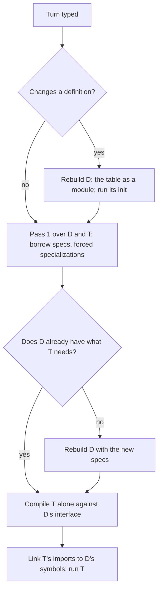

# Plan: Compiled evaluation at the `tur repl` prompt

> **Status:** C0 landed 2026-09-30. **C1 landed 2026-10-02** behind
> `--enable=repl-jit-inline-c`, went **beta on 2026-10-04** once its value
> boundary closed and its surface was frozen as the "Supported subset" under
> C1, and **graduated 2026-10-17** (0.65 line, past its advisory `expires_at`
> of 0.65.0): on by default on every `TUR_JIT` build, with
> `TUR_REPL_JIT_INLINE_C=0` as the off switch. C2 was investigated 2026-10-02 and
> again 2026-10-04 (findings under C2); **its steps 1 and 2 landed 2026-10-28/29**
> behind `--enable=compiled-repl` (prototype): every turn compiles the
> session's definition table plus the turn, and its globals live in host
> slots (C2, "Step 1, as built" and "Step 2, as built"). Point 5's
> image-memory decision went to option (a) on 2026-10-29: a turn keeps only its
> program's code and data, not its MIR context (C2, "Point 5, option (a), as
> built"); results print through Show or their constructors, and redefining a
> type drops the defs holding its values (C2, "Point 8 and type redefinition");
> a panic ends only its turn, a continuation cannot outlive one, and Try
> Turmeric has compiled turns behind a checkbox under Compile (C2, "The page").
> Split images (C5) were chosen and then **deferred the same day**: most of a
> turn's program is not the session's definitions but stdlib baggage every
> program carried, and the JIT pruner now drops it (C2, "The stdlib baggage,
> pruned"): a kept turn on the page went from ~394 KB to ~229 KB.
> **Rewritten 2026-09-29.** The 2026-06-28 draft (in
> git history) proposed compiling each prompt form with a `cc` subprocess into
> a `.so` and `dlopen`ing it. It predates the in-process MIR JIT (graduated
> 0.34.0). The JIT and the spice REPL now provide most of the machinery the
> draft planned to build, and the draft had design flaws this version fixes
> (see "Why not the 2026-06-28 draft"). The file name is historical: nothing
> here is ahead-of-time compiled any more.
> **Last Updated:** 2026-10-29 (stdlib baggage pruned; C5 deferred)
> **Track:** post-v1. C0 (a bug fix) and C1 (graduated) have landed.
> **Type:** REPL / interpreter (`src/turi/`) / JIT (`src/jit_engine.c`) /
> emitter (REPL-mode globals).
> **Requires:** a `TUR_JIT` build. Since 2026-10-02 that is the default on
> 64-bit x86-64 and arm64: MIR is vendored under `external/mir/`, so a default
> configure no longer reaches the network, and the release binaries carry the
> engine. That resolves Open question 1.
> **See also:** [jit-guide](../guides/jit-guide.md),
> [spice-repl-plan](../archive/spice-repl-plan.md),
> [jit-engine-plan](../archive/jit-engine-plan.md) (J2 image mode),
> [jit-ffi-c2mir-plan](../archive/jit-ffi-c2mir-plan.md),
> [cc-path-preamble-split-plan](cc-path-preamble-split-plan.md).

## Goal

Let a user type any Turmeric at `tur repl` and have it run the way `tur build`
would run it: inline-C, native layout, compiled semantics. The REPL must keep
its workflow while doing so: state carries from turn to turn, and anything can
be redefined.

The gap is concrete today. The interpreter runs an inline-C body only if it
recognises the pattern (`try_exec_simple_inline_c`, `src/turi/eval.c:5899`),
and refuses the rest. Piped into `tur repl` on `main` (`c6ba4162`):

````text
(defn seven [] : int
  ```c
  return 7;
  ```)
(seven)
(defn c-mix [a : int b : int] : int
  ```c
  int64_t t = a;
  return t * 31 + b;
  ```)
(c-mix 3 4)
````

```text
=> #<fn seven>
=> 7
=> #<fn c-mix>
error: eval: inline-C not supported in interpreter mode (function uses a native C implementation; run it with `tur build`/`tur run` instead of `--interpret`)
```

The same `c-mix` in a file prints `97` under `tur jit`. Until C0 landed, adding
a `for` loop to the body made things worse: the REPL could not even read the
form. Since C1, `tur repl` prints `97` too (behind
`--enable=repl-jit-inline-c` until C1 graduated on 2026-10-17).

## What already exists

| Piece | Where | What this plan uses it for |
| --- | --- | --- |
| Incremental elaboration session (TR2.2b) | `TuriEnv.elab_session`, `src/turi/env.h:261`; on by default (`incremental_elab`, `:230`) | Checks each turn against earlier turns without re-elaborating them. Applies the REPL's redefinition rules (`elab_prior_turn_global`, `src/compiler/elab_core.c:2505`) and gives the turn's result type |
| JIT image mode (J2) | `tur_jit_compile_image` / `tur_jit_image_sym` / `tur_jit_image_free`, `src/jit_engine.h:74-103` | Compiles emitted C in process, links it against `tur`, runs `__tur_static_init`, and finds functions by C name, static ones included |
| Split runtime | `jit_try_split_preamble`, `src/driver/preamble_split.c` | Every image links against the one runtime inside `tur` instead of carrying its own copy of the preamble's state |
| Repeated in-process compile | `repl_jit_build` and its `compile_to_c` call, `src/driver/jit.c` | Precedent for running the front end and emitter inside the REPL process on every `(reload)`, saving and restoring `g_interpret_mode` / `g_emit_for_link` around it |
| Old images stay resident | retired list, `src/turi/ffi_thunk.c:494-507` | The lifetime rule: never free an image something may still point into |
| Exports manifest and scalar marshaling | `g_manifest_sink` (`src/driver/jit.c:repl_jit_build`), `tur_ffi_install_spice_bindings`, `src/turi/ffi_thunk.c` | Binding a compiled function as an interpreter native: C name, signature, and int/float/cstr/bool/nil marshaling |
| C1's mid-turn compile (2026-10-02) | `repl_inline_c_jit_build` (`src/driver/jit.c`), `src/turi/inline_c_jit.c`, `repl_jit_compile_image(..., prune, ...)` | Compiling inside a turn without disturbing it: diagnostic-registry save/replace, emission-flag save/restore, `jit_prune` on an image TU, quiet c2mir warnings |
| Lean resident images (2026-10-02) | `tur_jit_compile_image` releases the C front end once an image is initialized | An image costs ~1.6 MB resident instead of ~28-62 MB, which is what makes "keep every image" thinkable (C2, point 5) |
| Vendored MIR, `TUR_JIT` on by default (2026-10-02) | `external/mir/`, `cmake/mir.cmake`, `CMakeLists.txt` | Every default build and release binary carries the engine |

## Why not the 2026-06-28 draft

- **Latency.** It assumed under 60ms per form from `clang -O0` on a ~50-line
  file. The emitted C for a one-line program is 9,545 lines, and `cc -O0 -g0
  -c` on that alone takes ~525ms (gcc 13) or ~150-290ms (clang 18). The draft
  also recompiled the whole growing session on every form.
- **`tur build --shared` refuses a single file** ("requires a directory
  argument (single-file builds emit static symbols)"). The symbol S2 would
  have `dlsym`'d does not exist.
- **Unloading the previous library is unsafe.** Closures, function pointers,
  string literals and instance dictionaries that point into it outlive it,
  and the OS does not track heap pointers. The spice reload already learned
  this and keeps old images.
- **Every `.so` carried its own runtime state** (allocator, regions, interned
  symbols, thread-locals). A value made by one generation would be consumed
  by another generation's runtime.
- **An append-only session cannot redefine.** A second `(def x ...)` or
  `(defn f ...)` in one file is an "already defined" error. (Until
  2026-09-30 the `defn` case got past the front end and failed in the C
  compiler instead:
  [duplicate-defn-in-one-file-reaches-the-c-compiler](../archive/duplicate-defn-in-one-file-reaches-the-c-compiler.md).)
  The draft's registry also looked a `def` up *before* initializing it, so a
  re-`def` would have kept the stale value. The interpreter re-initializes.
- **A `void *` registry** cannot hold floats or by-value aggregates. Storing
  into it is also an escape store, which CLAUDE.md's "Region Store Hooks"
  rule requires to be noted.
- Smaller:
  - `TUR_M7_HKT=0` has been retired.
  - `(module ...)` and `instance` are really `defmodule` and `definstance`.
  - There is no `TUR_DEBUG` variable.
  - `src/runtime/globals.c` holds CLI configuration, not runtime code.
  - The value converters in `ffi_thunk.c` handle scalars only.
  - The inline-C example used a syntax that does not exist.

What survives from the draft: the goal, a host-owned table that keeps `def`
state across compiles (fixed below), and `:reset` as the clean slate.

## Measurements (2026-09-29)

Release `-DTUR_JIT=ON`, x86-64 Linux, 4 cores, `main` at `c6ba4162`.
Timings are best of 3, end to end. `compile_ms` comes from `tur jit
--timing-json` and covers c2mir plus link, on the split runtime.

| Program | Emitted C | `tur emit-c` | `tur jit` compile_ms | `tur jit` wall |
| --- | --- | --- | --- | --- |
| one `defn` + `main` | 9,545 lines | ~23ms | ~110ms | ~135ms |
| 200 small `defn`s | 11,762 lines | ~37ms | ~115-125ms | ~140-160ms |
| 800 small `defn`s | 18,362 lines | ~100ms | ~170-180ms | ~195-210ms |

For comparison, `tur build` of the one-line program takes ~210ms.

In process, a compiled turn pays roughly the `emit-c` column plus the
`compile_ms` column. That is ~130ms for a small session, growing slowly with
the number of definitions. C2 is designed around that budget, and C4 lists
the ways to reduce it.

## Design

### C0 -- the prompt must accept a multi-line inline-C form (LANDED 2026-09-30)

This was a bug fix:
[repl-continuation-counter-misreads-reader-syntax](../archive/repl-continuation-counter-misreads-reader-syntax.md).
A `for (...;...;...)` inside a fence kept the `..` prompt open forever, and a
`')'` char literal made the REPL evaluate the form halfway through the fence.
The REPL now asks `reader_open_depth` (`src/compiler/reader.c`) whether the
input is complete, and keeps a blank line typed inside a fence or string.
C1 and C2 could not be tested at an interactive prompt without it.

### C1 -- JIT the inline-C `defn`s the interpreter cannot run (LANDED 2026-10-02, BETA 2026-10-04, GRADUATED 2026-10-17)

The smallest change that closes the gap. The interpreter stays the evaluator,
and only the inline-C bodies it refuses get compiled. It was experiment
`repl-jit-inline-c` (a prototype from 0.59.0, beta from 2026-10-04, advisory
`expires_at` 0.65.0) and is now always on; it applies wherever turi runs with
the inline-C capability, so `tur repl` and `tur --interpret` alike. The
`c-mix` example above prints `97` at the prompt and under `--interpret`. Try
Turmeric's prompt has it too, under the Compile engine, since 2026-10-28: the
browser JIT module installs its own hook (wasm-jit-plan P6,
`src/web/wasm_jit_glue.c`), and images run on MIR's interpreter.

**Graduation (2026-10-17).** The row left `EXPERIMENTS[]` for `GRADUATED[]`,
so a lingering `--enable=repl-jit-inline-c` was a `TUR-W0063` no-op for one
minor line (it aged out at 0.71.0 and is `TUR-E0310` now). The frozen "Supported subset"
below is the shipped surface. `TUR_REPL_JIT_INLINE_C=0` restores the "inline-C
not supported" error, for bisection and for the two harnesses that test the
pattern executor on its own (`run-interp-show-inline-c.sh`,
`run-interp-inline-c-constructor.sh`); `tests/turi/repl-jit-inline-c.sh` keeps
that off path covered, at the prompt and under `--interpret`.

**Re-measured at the graduation** (Debug, x86-64 Linux, `main` at
`52ce19d7`): the 842 fixtures with user inline-C, an `expected.stdout`, and no
args, stdin or flags, under `tur --interpret`, with the JIT off
(`TUR_REPL_JIT_INLINE_C=0`) and on. Off: 321 pass. On: 379 pass. No fixture
that passes with it off fails with it on. Of the 58 that pass only with it on,
`run-turi.sh` now runs 52 (the 46 below plus six); the rest are skipped there
by a marker, measure the process heap, or pass by luck (next paragraph). 14
fixtures crash either way; those are interpreter crashes in the inline-C
carve-out and have nothing to do with the JIT.

What graduation accepted, rather than fixed:

- **Four programs crashed with the JIT on** (three since 2026-10-17) that
  failed cleanly ("inline-C not supported") with it off, and since the
  graduation nobody has to opt in to reach them:
  - `typeclass-unsafe-passbyptr-struct-arg` and `option-result-c-abi` are
    `:int` handle stand-ins, which CLAUDE.md already forbids. The second
    returns a compiled Option box as `:int`, and `(:: ... (Option int))`
    then has `try_retag_carrier_struct` (`src/turi/eval.c`) read it as an
    interpreter struct.
  - `re-union-patterns` was the ownership row: compiled code that `free`s a
    `cstr` argument the interpreter owns (`str-free` over a `str-concat`
    result, from `(load "stdlib/str.tur")`). Correctly typed code can write
    that, so it was the one gap left in the boundary. **Closed 2026-10-17** by
    the boundary's third check (below): a string the interpreter made goes
    over as a copy. The fixture now runs to the end; its one wrong line is an
    interpreter divergence with nothing to do with the JIT,
    [turi-null-cstr-ascribed-int-stays-a-cstr](../archive/turi-null-cstr-ascribed-int-stays-a-cstr.md).
  - `defer-cps-abortive-handler` is not the JIT's at all: its `note` is an
    in-subset `cstr -> int` body, and compiling it only lets the program run
    far enough to reach an interpreter use-after-free that reproduces with no
    inline-C anywhere:
    [turi-defer-in-stored-continuation-use-after-free](../archive/turi-defer-in-stored-continuation-use-after-free.md)
    (resolved 2026-10-18). Past it, the fixture still diverges under the
    interpreter on the timing of an abandoned body's defers:
    [turi-fiber-handle-defers-fire-at-the-wrong-time](../archive/turi-fiber-handle-defers-fire-at-the-wrong-time.md).

  The two `:int`-result crashes recorded on 2026-10-04,
  `closure-drop-affine-chain-autodrop` and `httpd-mw-fold-many`, now pass.
  They still launder a compiled handle through `:int`, so they pass by luck
  and are not in `run-turi.sh`'s list.
- **Macro-time evaluation is unaffected.** The macro env denies
  `TURI_CAP_INLINE_C`, and `eval_apply_driven` checks that capability before
  the JIT is reached, so a `defmacro*` never compiles C mid-compile.
- **Embedders still cannot reach it.** Only `tur`'s `main.c` installs the
  compile hook, so libturi embedders (the notebook spice) keep the error:
  [notebook-cells-cannot-call-inline-c-spices](../reported/notebook-cells-cannot-call-inline-c-spices.md).

**As built.** `src/turi/inline_c_jit.{h,c}` is the MIR-free half, in
`tur_core`. The compile is a hook that `tur` registers from `main.c` on a
`TUR_HAVE_JIT` build (`repl_inline_c_jit_build`, `src/driver/jit.c`), so a build without an engine
has no hook and keeps today's error.

- **Trigger.** `eval_apply_driven` (`src/turi/eval.c`), straight after
  `try_exec_simple_inline_c` declines -- the point where the body would
  otherwise reach "inline-C not supported". It applies to user code only
  (`!is_from_stdlib`). The stdlib's inline-C is answered by native overrides
  first, or by interpreter intercepts that run on the error path itself: the
  session channel templates, and `gc_force`. Compiling those would bypass the
  intercepts.
- **Cache.** One entry per `FnDef`, holding either the compiled shim or the
  refusal message. A redefinition elaborates a new `FnDef`, so it misses the
  cache and compiles afresh. The old entry and the old image stay, under the
  same retired-image rule as the spice reload. A refusal is cached too, so a
  body c2mir rejects costs one compile, not one per call.
- **Signature first.** Before compiling, every parameter and the result must be
  a scalar the emitter's `NAME__ffi` shim marshals: int-class, float, cstr,
  bool, or a unit result. Anything else is refused with the type named (`takes
  a parameter of type Pt`).
- **Source.** The defn's own text, sliced from the file it was read from by the
  span elaboration records on the binding (`Binding.defn_claim`, set for every
  top-level `defn`). That covers the prompt, `--interpret`, and defns brought
  in with `(load ...)`. A reader whose text the plain reader cannot read back
  (neoteric, sweet) falls back to printing the session's Form. A defn written
  by a macro has neither, and is refused.
- **Program.** `(defmodule __repl-jit (export NAME) <defn>)`. That is narrower
  than the plan above proposed. No type definitions ride along, because the
  signature check admits only scalars, so a signature can never name one.
- **Compile.** `compile_to_c` on a scratch file under `$TMPDIR` named after the
  defn, with the emission flags `repl_jit_build` saves. The manifest supplies
  the C name, and `g_emit_ffi_export_shims` supplies the shim. The compile runs
  mid-evaluation, so the host puts back everything `compile_to_c` resets that
  the turn still uses: the diagnostic file registry (the turn's source is file
  id 0) and the had-error flag. c2mir's warnings are suppressed for these
  compiles (`tur_jit_set_quiet_warnings`); its errors still print. The TU is
  pruned like `tur jit`'s (`jit_prune`), with one non-static caller appended
  to keep `__tur_static_init` alive.
- **Call.** Through `NAME__ffi`, which casts each slot to the real C parameter
  type. The result is tagged by the declared type, so a cstr comes back as a
  cstr and a bool as a bool. The spice export shim, by contrast, returns every
  int-class result as an int.

**Refusals.** Each is an error value, and the session carries on:

- A body that calls another Turmeric definition. Only the defn is compiled, so
  MIR's link fails (`import of undefined item helper`).
- A non-scalar signature.
- A variadic defn.
- A defn written by a macro.
- An inline-C block that is not a defn's whole body, such as one inside a `let`
  or a Turmeric body. Those stay "inline-C not supported".

**Found on the way, fixed.** The pattern executor's `simple-return` matcher
answered with the *first* `return` in a body, even one behind a loop or an
`if`. So `all-even` printed `false` for `(all-even 4 8)` under `--interpret`,
rc=0 and no warning, and C1 never saw the body. It now declines a body with a
loop or more than one `return`:
[turi-inline-c-simple-return-takes-first-return](../archive/turi-inline-c-simple-return-takes-first-return.md).

**What an image costs, and what changed for it.** Measured on the C1 path,
Release, x86-64 Linux, 4 cores. The baseline is the image path as it was
(unpruned TU, C front end kept until the image is freed):

| | first compile | resident after 51 compiles |
| --- | --- | --- |
| as it was | ~235 ms | 3.2 GB (~62 MB per image) |
| + `jit_prune` on the C1 TU | ~130 ms | 1.4 GB (~28 MB per image) |
| + C front end released once the image is initialized | ~135 ms | 116 MB (~1.6 MB per image) |

The C front end -- parsed system headers and runtime declarations -- was most
of an image, and nothing reads it after the module is linked: generation works
from MIR's own IR. So `tur_jit_compile_image` now calls `c2mir_finish` as soon
as the image is initialized, for every image, including the spice REPL's and
the dynamic FFI's thunks. `TUR_JIT_KEEP_C2MIR=1` restores the old lifetime.
120 consecutive compiles in one Release session returned 120 correct results.
In a 51-compile session the compile share averages ~155 ms; the interpreter's
own share of that session is ~700 ms in total.

**The value boundary (found 2026-10-04, fixed).** The signature check above is
not a safety boundary on its own. A `ptr<void>`, `:int` or un-annotated
parameter is one machine word, and an interpreter value reaches compiled code
through it as a bare address: a vec the interpreter's natives built, an
existential the interpreter packed, a cons list, a Result. Compiled code then
reads it with the compiled layout, and frees, reallocs or keeps memory the
interpreter allocated from its own arenas. Measured over the fixture corpus
(below): **26 fixtures that failed with a clean "inline-C not supported" error
without the flag crashed the process with it** (SIGABRT from `free` on arena
memory, or SIGSEGV), and 14 more passed only because the interpreter happened
to lay a value out the way compiled code reads it (cons cells, Result) -- luck,
not a contract.

Three call-time checks now close what the runtime can see
(`src/turi/inline_c_jit.c`, "The value boundary"):

1. **Provenance for pointers.** Every non-zero result of a JIT'd call
   declared `ptr<void>` (or, since 2026-10-17, `cstr`) is recorded. A `ptr<void>` parameter accepts only nil
   or one of those: a handle compiled code made may go back to compiled code,
   and nothing else may. (`make-cell` then `cell-get` round-trips; a packed
   existential is refused, and so is an address a defn returned as `:int`.)
   Only pointer results count: recording every int-class result let any
   number a JIT'd call had returned pass as a handle, and grew the table
   with every distinct number.
2. **No interpreter memory in an int-class slot.** A word that addresses the
   interpreter's value arenas (`arena_owns` on `value_scratch`/`value_perm`) or
   a collection it tracks is refused, whatever the parameter's declared type.
3. **A string argument is the callee's (added 2026-10-17).** A `cstr` value
   the interpreter made reaches compiled code as a `malloc`'d copy, whatever
   the parameter's declared type, so compiled code may read, free or keep it,
   as it may a string a compiled caller hands over. Before, it got the
   interpreter's own string: freeing it was a bad free that ended the session,
   and keeping it read garbage once the arena moved on (measured: a string
   kept in one REPL turn read back wrong on the next). A string compiled code
   returned (recorded by check 1) goes back as itself, so a buffer compiled
   code made keeps its identity and its writes. The cost is a leak of
   strlen+1 bytes per call when compiled code only reads the copy; nothing
   can tell that from a body that frees it. The copies are made only once
   every argument has passed, so a refused call allocates none.

Each refusal is an error value naming the argument, and the session carries
on. Checks 1 and 2 turned 22 of the 26 crashes into refusals and gave up the
14 lucky passes; check 3 turned the ownership row's crash into a run.

**Supported subset (frozen for the beta; the graduated surface).**

| | Supported | Refused, cleanly | Outside the subset -- undefined, not detected |
| --- | --- | --- | --- |
| Shape | a `defn` whose whole body is inline-C, fixed arity, written out (not by a macro) | a body calling another Turmeric definition; variadic; macro-written; partial inline-C | -- |
| Parameters | int-class numbers, `float`, `bool`, `cstr` (the callee's own copy, unless compiled code made it), `ptr<void>` holding nil or a JIT'd handle | struct/ADT/closure/collection types by name; at the call, an interpreter value in a pointer slot or interpreter memory in any int-class slot | an `:int` that smuggles a handle from somewhere else (CLAUDE.md "No lazy `:int` stand-ins" already forbids it) |
| Result | int-class, `float`, `bool`, `cstr`, unit, `ptr<void>` | any other type | -- |
| Ownership | compiled code reads its arguments, and may `free` or keep a `cstr` argument (check 3, since 2026-10-17) | -- | -- |

The four fixture crashes left on 2026-10-04 were all in the last column
(`re-union-patterns`' ownership crash closed on 2026-10-17, by check 3):
`typeclass-unsafe-passbyptr-struct-arg` (`__build [lst : int]` walks an
interpreter cons list it was handed as `:int`), `re-union-patterns`
(`str-free` frees an interpreter `cstr`), and `closure-drop-affine-chain-autodrop`
/ `httpd-mw-fold-many` (an `:int` result that is a compiled-heap handle, later
dropped by the interpreter's own glue -- the second prints its full expected
output and aborts at exit). None is reachable from code that types its handles.

**Payoff beyond the prompt, measured 2026-10-04** (Debug, arm64 macOS, `main`
at `59d1dfe5c`). Of the fixtures with user inline-C, 766 have an
`expected.stdout` and no args, stdin or flags. Under `tur --interpret`:

| | pass | fail | crash introduced by the flag |
| --- | --- | --- | --- |
| no flag | 311 | 455 | -- |
| C1 as landed (measured at `4fb2606bb`, 760 fixtures) | 370 | 390 | 26 |
| C1 with the value boundary | 357 | 409 | 4 (the column above) |
| at the graduation (Debug, x86-64 Linux, 842 fixtures; see C1's "Re-measured") | 379 | 463 | 4 (see "What graduation accepted") |
| with the `cstr` copy, check 3 (2026-10-17, Debug, x86-64 Linux, 843 fixtures) | 380 | 463 | 3 (`re-union-patterns` now runs to the end) |

No fixture that passes without the flag fails with it. **`run-turi.sh` now runs
the 46 that pass only with the flag** (`TURI_INLINEC_JIT_RUN`) on any build
whose `tur` carries the JIT engine -- with `--enable=repl-jit-inline-c` until
the graduation, with no flag since; without an engine they stay in the
carve-out. Each was checked stable across three consecutive runs. The
graduation re-measure added six more (52), checked the same way.

The failures that remain are mostly not C1's to fix: 120 struct/ADT/closure
signatures, about 20 bodies that call Turmeric code, and the interpreter gaps
(arrow instances, async/await, task groups) that fail identically without the
flag.

**Test.** `tests/turi/repl-jit-inline-c.sh` (ctest `tur_repl_jit_inline_c`,
registered on `TUR_JIT` builds, in the `test` job's aux part). It covers:

- the off switch (`TUR_REPL_JIT_INLINE_C=0`, the gate before the graduation),
  at the prompt and under `--interpret`;
- the default on, with no lifecycle warning, and the old `--enable` accepted
  as a `TUR-W0063` no-op;
- loop and branch bodies;
- a hoisted `#include`;
- float, cstr and bool signatures;
- a cached second call;
- redefinition dropping the cache;
- both refusals;
- the value boundary: a compiled handle round-trips through `ptr<void>`, nil
  passes, a packed existential is refused at a pointer parameter, a vec is
  refused at an `:int` parameter, and a plain number still passes;
- a string argument is the callee's: compiled code frees a literal and a
  `str-concat` result (one through an un-annotated parameter) with no bad
  free, a string kept in one turn reads back right in the next, and a string
  compiled code made comes back with compiled code's write to it;
- `--interpret`;
- no scratch file left behind.

### C2 -- compile whole turns

With experiment `compiled-repl` on, every prompt turn runs as compiled code.



**Checking.** The existing elaboration session stays the front door. Each turn
is elaborated against it exactly as today. That keeps the interpreter's
redefinition rules and diagnostics, and gives the turn's result type. A turn
that fails there never reaches the compiler.

C2 needs one new path in `turi_eval_impl`: commit the elaboration (the
session, `acc_forms` and `src_acc`) *without* evaluating. In compiled mode
the interpreter never evaluates a turn, so there is exactly one copy of the
program's state: the slot table below.

**Definition table.** The compiled side keeps the latest source form for each
top-level name, in the order names were first defined. A redefinition replaces
its entry in place, which is what the draft's append-only file could not do.
Entries are keyed by:

- the defined name, for `def`, `defn`, `defstruct`, `defdata`, `defmacro` and
  the other definers;
- `(class, head)`, for `definstance`.

`import` and `load` forms are kept in order and deduplicated.

**One program per turn.** Each turn compiles the whole definition table plus a
synthesized zero-argument entry function. The entry evaluates the turn's
expression and prints it in the interpreter's `=> ` format. It uses the value's
`Show` instance when there is one, a `println` overload for scalars, and
`#<Type>` otherwise. The printing happens in compiled code, so the host never
has to convert a result back into an interpreter value.

The whole program is recompiled on purpose, because some emitter facts depend
on the whole program. Ownership provenance (`src/compiler/emit_core.c:6749`)
decides whether a parameter is owned by looking at every call site, and
monomorphized clones are minted only for call sites that exist. Compiling only
the new form would let a later turn change a fact that earlier code was
compiled under. Recompiling everything is correct by construction; C4 is where
it gets cheaper.

**Globals live in host slots.** Today a `def` compiles to `static T name_N;` in
the image, assigned in `__tur_module_def_init`. For example, `(def ^mut n 5)`
emits `static int64_t n_4;`. In REPL-compiled mode the emitter instead emits a
pointer, bound at init to a slot the host owns:

- `tur_repl_slot(name, fingerprint, size, align, &fresh)` returns the slot for
  a Turmeric name. The slot's size and alignment come from the C type, so
  floats and by-value aggregates fit. The fingerprint is the def's type plus a
  hash of its form.
- The initializer runs only when the slot is `fresh`: a new name, a changed
  form, or a changed type. This matches the interpreter. There,
  `(def ^mut n 5)` then two `(bump)`s print `6`, `7`; `(def ^mut n 100)` then
  `(bump)` prints `101` (`bump` increments `n`). The draft's registry would
  have kept the stale value.
- Slots are keyed by the Turmeric name, not the C name. The `_4` suffix
  depends on elaboration order and changes between turns.
- Slots are shared through pointers rather than copied into and out of each
  image. A closure made in turn N keeps running turn N's code; with per-image
  copies it would read turn N's stale values. With slots, every image reads
  the same storage.
- A slot outlives every `with-region` / `bt-scope` bracket, so a store into
  one is an escape store (CLAUDE.md "Region Store Hooks"). `set!` on a global
  already notes its word with `TUR_REGION_NOTE_WORDS`, and the slot-backed
  initializer store must do the same. The REPL tests get a case for this: a
  value allocated inside a bracket, stored in a `def`, and read after the
  bracket exits.
- The slot table lives in `tur`. Images reach it through the host's exported
  symbols, the same way they reach the split runtime (`ENABLE_EXPORTS` under
  `TUR_JIT`, `src/CMakeLists.txt:549`).

**Image lifetime.** Every turn's image stays resident until `:reset`, as with
the retired-list rule. Slots can hold pointers into any earlier image: string
literals, closures, instance dictionaries. `:reset` frees every image and
every slot together, which is the only point at which nothing can still refer
to them. C2's acceptance includes measuring resident memory over a long
session.

**Differences from the interpreter**, to be documented:

- A function value captured in an earlier turn keeps that turn's code. Direct
  calls always reach the latest definition, because each turn recompiles every
  caller.
- A crash in compiled code (segfault, `abort`) ends the REPL process. The
  interpreter reports some of these as errors instead. See Open question 3.
- A continuation or fiber captured in one turn and resumed in a later one would
  cross images. Refuse it with a diagnostic until someone designs it.
- Turns in a `#lang` other than `turmeric` stay interpreted.

**No silent fallback to the interpreter.** If c2mir rejects a turn, report the
error. Interpreting that one turn would read and write the interpreter's copy
of the globals rather than the slots, and the two states would drift apart. A
`cc` fallback that shares the slots is possible (Open question 1).

**Meta-commands.**

- `:type`, `:doc` and `:expand` use the elaboration session and are
  unchanged.
- `:reset` drops the definition table, the images and the slots.
- `:run` / `:reload` feed a file's forms through the same turn path.

A loaded spice (RP3) is out of scope for C2; see C3.

#### Step 1, as built (2026-10-28)

Behind `--enable=compiled-repl` (prototype, introduced 0.72.0). The
recommendation's first item: the step-7 branch and the definition table, with
per-program globals.

- **Where.** `src/turi/compiled_turn.{h,c}` (engine-free, `tur_core`) owns the
  definition table and builds the program; the compile-and-run is a host hook,
  `g_repl_compiled_turn_hook` (`src/driver/jit.c`), installed by `tur`'s
  `main.c` on a `TUR_HAVE_JIT` build. `repl_fresh_env` turns the session's
  `compiled_repl` on after the preload, so the stdlib stays the
  interpreter's; `#lang`s other than `turmeric`, and the sweet/neoteric
  readers, stay interpreted.
- **The turn.** Step 7 of `turi_eval_impl` calls `turi_compiled_turn_run`
  instead of `eval_toplevel_guarded`; its result feeds step 8 unchanged, so the
  session commits a turn only when its program compiled and exited 0.
- **The table.** Each new form is a definition (keyed `defn f`, `def x`,
  `defstruct Pt`..., `definstance Show Pt`; `define` is `def`), an import
  (`import`/`load`/`require`/`use`, kept in order, deduplicated by text), or
  an expression. A definition replaces its entry in place. The table changes
  only when the turn ran.
- **The program.** The imports, five inline-C printers, the table, and
  `(defn main [] : int <turn> 0)`. `main` runs the turn's expressions and
  prints the last as the REPL would: `%lld`, `%g`, a quoted string,
  `true`/`false`, `nil` for a unit result, `#<fn>` for a function value, a
  defn as `#<fn f>`, a def as its value. A type definition prints nothing and
  the REPL shows its `#<struct-type Pt>` sentinel itself. The host runs it as
  `tur jit` runs a file (split, prune, `tur_jit_execute`, the full-preamble
  retry) and keeps nothing resident.
- **Tests.** `tests/turi/repl-compiled.sh` (ctest `tur_repl_compiled`): a
  transcript of scalars, definitions and a redefinition prints the same
  `=>` lines compiled and interpreted; inline-C defns compile with the turn;
  a turn that fails to elaborate, or to compile, leaves the table as it was;
  step 1's differences are pinned; without the flag nothing changes.

**Differences from the interpreter, step 1:**

- Every initializer re-runs each turn, so a mutation of a global lasts one
  turn: `(def ^mut n 5)`, then `(bump)` twice prints `6`, `6` (interpreted:
  `6`, `7`). Step 2's slots fix it (below), and a `def` whose initializer has
  an effect repeats that effect every turn until then.
- A value with no scalar printer prints `#<Type>` -- `#<Pt>`, `#<(Vec int)>`
  -- where the interpreter uses its `Show` instance or its struct repr (the
  plan's turn-entry printer, point 8).
- A name only the interpreter's natives answer (it warns `unknown name ...;
  will runtime-dispatch` and finds a native) is an error in the compiled
  program, as it would be under `tur run`. The turn fails and the session
  carries on.
- A panic or a non-zero exit fails the turn (`the turn's program exited
  non-zero`).

**Cost.** Release, x86-64 Linux, 4 cores: a session of N one-line defns, then
ten expression turns calling the last one, every turn compiled.

| N | turns | compiled, total | per turn | interpreted, total |
| --- | --- | --- | --- | --- |
| 1 | 11 | 1.5 s | ~136 ms | 0.02 s |
| 50 | 60 | 8.0 s | ~134 ms | 0.03 s |
| 200 | 210 | 27.1 s | ~129 ms | 0.03 s |

Flat in the session's size, as the 2026-10-04 look predicted: the prune keeps
only what `main` reaches, so the fixed c2mir floor is the cost. That is
inside the 200 ms budget here; on arm64 macOS the floor alone was ~245 ms, so
C4 item 2 still decides that platform. Nothing stays resident, so step 1 has
no image-memory question; step 2's slots bring it back.

#### Step 2, as built (2026-10-29)

The recommendation's second item: globals in host slots. With it, a compiled
session's globals behave as the interpreter's: the transcript of a mutable
global bumped across turns, then redefined, then read by a closure from an
earlier turn, prints the same `=>` lines both ways (`tests/turi/repl-compiled.sh`).

- **The emitter** (`g_emit_repl_slots`, set only by the compiled turn's
  compile; ordinary emission is byte-identical, every snapshot regenerated
  unchanged): a top-level `def` of the program's own -- not the stdlib's, not
  an imported library's, not a `^thread-local` -- is
  `static T *__tur_slot_x_N; #define x_N (*__tur_slot_x_N)` in place of its
  storage, point 6's shape, and so is its forward declaration (a lifted
  lambda is emitted before the def and must reach the slot too). Its
  initializer binds the pointer with `tur_repl_slot("x", "<type>", size,
  &fresh)` and runs only when the slot is fresh; the store notes its word
  (`TUR_REGION_NOTE_WORDS`), since a slot outlives every region bracket.
- **The slots** (`tur_repl_slot`, `turi/compiled_turn.c`, resolved through
  the engine's `JIT_SHIMS` so the wasm module finds it too): keyed by the
  Turmeric name. Fresh when the name is new, when its type or size changed
  (new storage; the old stays for earlier turns' code), or when the turn
  redefines it (the same storage, initialized again -- so a closure from an
  earlier turn sees the new value, as interpreted). `:reset` drops the table.
- **Programs stay resident** (`tur_jit_set_keep_contexts`): a slot can hold a
  pointer into the program that made it -- a string literal, a function. Only
  the C front end is released after a turn, as for an image. Code is
  generated eagerly, since a function of an earlier program may be called by
  a later one after lazy generation moved to another context.
- **The region case** the corpus list asks for: a `^heap` node made inside a
  `with-region` and kept in a `def` (by the initializer, and by `set!` from a
  function), read in a later turn, prints its field.

**Cost, step 2.** The same Release build and sessions as step 1:

| session | turns | total | per turn | peak RSS |
| --- | --- | --- | --- | --- |
| 1 defn + 10 calls | 11 | 1.7 s | ~155 ms | 67 MB |
| 50 defns + 10 calls | 60 | 11.1 s | ~185 ms | 135 MB |
| 200 defns + 10 calls | 210 | 48.7 s | ~232 ms | 312 MB |
| 1 defn + 999 calls | 1,000 | 345 s | ~345 ms | 1,221 MB |

Resident memory after 1,000 turns -- the success criterion's number -- is
**1.2 GB, ~1.2 MB per turn**. And the per-turn time now grows with the
session (turns 1-50 ~188 ms, 251-300 ~302 ms): stack samples late in a long
session are all in c2mir's parse and in malloc/free, nothing linear in the
slot or definition tables, so it is the allocator working through the
resident heap. Both say the same thing: point 5's image-memory decision, (a)
or (b), is what C2 needs before it can soak, and it is now measured rather
than estimated.

#### Point 5, option (a), as built (2026-10-29)

Decided: (a) first, (b) later if it is needed. Measured before building, a
kept context was ~1.3 MB a turn, and it broke down as: ~280 KB of fixed
tables `MIR_init` builds for every context (the symbol and string tables, the
scanner, the interpreter's thunk and interface tables, which a generated
program never uses); ~220 KB of generator state; ~140 KB of MIR instructions;
and the program's items. Releasing the generator and the instructions alone
saved a third. The fixed tables cannot be trimmed from outside MIR, and they
are the cost of one context per turn.

So nothing of the context is kept: only what a pointer from a slot can reach,
which is the program's machine code and its data sections
(`jit_finish_kept_context`, `src/jit_engine.c`).

- **Data:** `MIR_finish` frees a section head's storage only while its item's
  `addr` is set, so each head's `addr` is moved to a kept list and cleared
  first.
- **Code:** a kept context is created with its own code allocator
  (`jit_keep_code_alloc`). Its unmap keeps the pages up to the highest one
  ever made writable (every byte of code is written through a protect call)
  and releases the untouched rest of the 128 MB reservation.
- **Everything else** goes with `MIR_finish`, as for a context that is not
  kept. Generation is already eager under keep, so no function is left to
  generate from the IR that goes.

No MIR change. The kept pieces live for the process; `:reset` drops the
slots but does not unmap old code, since the runtime's own tables may still
hold a function pointer into it. Where the program runs on MIR's interpreter
(`TUR_JIT_GEN=interp`, and the wasm module, where the IR *is* the program)
the whole context stays, and Windows keeps it too, for want of the allocator.
`tests/turi/repl-compiled.sh` reads a string literal, a lambda and a static
table made in turn 1 a hundred turns later, under the ASan Debug build.

**Cost, after (a).** The same Release build and sessions as step 2:

| session | turns | before: total, peak RSS | after: total, peak RSS |
| --- | --- | --- | --- |
| 1 defn + 299 calls | 300 | 71.5 s, 409 MB | 39.8 s, 88 MB |
| 1 defn + 999 calls | 1,000 | 345 s, 1,221 MB | 143 s, 156 MB |

A turn now keeps ~0.1 MB (its code pages and data sections, plus the
session's own growth), down from ~1.2 MB, and the per-turn time no longer
grows with the session: turns 1-50 ~131 ms, 251-300 ~136 ms (step 2: ~188 ms
rising to ~302 ms). The slowdown was the allocator working through the kept
contexts' heap; finishing them is also why every turn got faster.

#### Point 8 and type redefinition, as built (2026-10-29)

**The printer.** A result prints as the interpreter's display prints it,
chosen from its static type when the turn's program is built (`emit_repr`,
`src/turi/compiled_turn.c`):

- scalars as before;
- **Show** when the session has an instance for the type's head and for each
  argument it is applied to (`Vec`, `Map`, `Set`, `Sym`, a user's own), through
  `(show v)`. The program then loads `stdlib/typeclass-show.tur`, which the
  interpreter preloads and a compiled program does not; so does a program
  whose own text uses `show`;
- a **struct or ADT** without an instance as `Name { field = value, ... }`, a
  constructor with no fields as `#<struct Name>`, four levels deep, by a
  generated `match`. A generic ADT's fields are typed by the arguments it is
  applied to;
- a **Vec** whose elements have no Show as `[a b]`, each element as the REPL
  would print it alone, by a generated loop; another container in that case,
  and anything else, as `#<Type>`.

Two fixes fell out of matching the transcripts. A positional field, `(Some
A)`'s, printed as `(null) = 3` in the interpreter; both now print `Some { 3 }`.
And a `#map{...}` / `#set{...}` literal's form span started at its `{`, so
the definition table copied `{:a 1}`, a curly-infix call; the reader now
spans the whole lexeme. The interpreter's display has two bugs of its own
the compiled printer does not share:
[repl-show-uses-wrong-instance-for-vec-elements](../reported/repl-show-uses-wrong-instance-for-vec-elements.md).

**Redefining a type.** The table re-elaborates every definition's source
against the latest types, and that can change what a `def` means: once `S`
grows a field, `(def s (S 1))` is a partial application, and the session --
which still says `s : S` -- printed the closure as a struct
(`S { a = 139737849398160, b = 1 }`). Changing a field's type was worse:
the stale def stopped compiling, so every later turn failed until `:reset`.
So each table entry for a `def` records its value's type as elaborated when
it was made, and a turn that redefines a type drops every `def` whose type
names it, saying so: `note: S changed, so the defs holding its old values are
dropped; define them again to use them: s`. Reading a dropped def is then a
compile error, not a misread value. (The interpreter keeps the old value in
its old shape; compiled code has one layout per name, the new one.) A `defn`
that no longer compiles against the new type still fails the turn that
redefines it; redefine both in one turn.

#### Continuations, fibers and panics across turns, as built (2026-10-29)

**A continuation stays in its turn.** A handler case's `(set! saved k)`
copies the chain (`dk_copy_range`) and registers it with the reaper, which
frees it when the program's entry returns -- for a REPL turn, at the end of
the turn. So a continuation stored in a top-level `def` is refused at compile
time: `a continuation stored in the top-level saved would outlive this REPL
turn ...`. Resuming one within the turn that captured it works. Probing this
found an emitter bug outside the REPL: that store, into any top-level `^mut`
global, was emitted as `*saved = ...` (a promoted local's cell spelling), so
the program did not compile at all. A global is now written in place
(`tests/fixtures/effect-stored-k-in-global`). Resuming a mutable that still
holds its initial `0` panics (`resume: not a continuation (0)`) instead of
storing through NULL. The interpreter has a bug of its own here:
[turi-repl-continuation-resumed-in-later-turn-reads-freed-frames](../reported/turi-repl-continuation-resumed-in-later-turn-reads-freed-frames.md).

**A region's retired generations live for the session.** A turn's program
registered `atexit(tur_region_shutdown)` like any program, and a turn drains
its atexit list when it ends, so the shutdown freed the retired generation a
`def` of a `with-region` node pointed into: the next turn read freed memory.
Only the Release build showed it (`tests/turi/repl-compiled.sh` with
`TUR=./build-release/tur`; the Debug build read the right value); the
emitter now leaves the shutdown out of a compiled turn.

**A fiber crosses turns.** Its stack is heap memory and its code is kept
(point 5), so a fiber made in one turn and stored in a `def` resumes from the
next, under ASan.

**A panic, `exit` or `abort` ends the turn, not the REPL** (Open question 3,
in part). The turn's program runs in the REPL's process, on an entry thread
(`jit_run_entry`); for a kept context that thread runs `main` under a
`sigsetjmp` landing. The program's `exit`, `_exit` and `abort` resolve to
shims that unwind to it, and the host's `abort()` -- where a runtime `panic`
ends -- arrives as SIGABRT on that thread and does the same. The turn fails
with the status a shell would see (`exited with status 3`, `134`), and the
next turn runs; the runtime's panic flag is reset so a second panic is not a
"double panic". This is the browser engine's 5.7 landing, natively and only
for REPL turns: `tur jit` keeps libc's. A segfault in compiled code still
ends the session.

#### The page, as built (2026-10-29)

Try Turmeric's Compile engine has C2 behind a checkbox under Compile in the
language menu, "Compile prompt turns too" (experimental, kept in
localStorage like the engine). With it ticked, the worker turns compiled turns
on for the JIT module's session (`turi_wasm_set_compiled_repl`), and every
prompt turn runs as a compiled program there. Switching it starts that session
afresh, since a compiled session's definitions are its own table.

- **The hook** is the driver's, again: `wasm_compiled_turn_run`
  (`src/web/wasm_jit_glue.c`) installs beside C1's, and compiles with the
  globals in slots, the split and the prune, then `tur_jit_execute` with the
  program kept. No full-preamble retry, as for a Compile Run.
- **The result's text** is now the host's, on both: the printers render into
  `tur_repl_result_piece`, the turn leaves it in `env->last_turn_text`, and
  `tur repl` prints it as its `=> ` line while `turi_wasm_eval` returns it as
  the prompt's result. Before, a compiled turn printed `=> ...` to stdout,
  which the page would have shown as program output.
- **A panic** ends the turn there too. The module's `abort()` throws out
  through JavaScript and would lose the worker, so under keep a program's
  `tur_panic_root_exit` and `tur_panic` resolve to shims that report as the
  runtime does, clear the thread's panic state (every turn runs on the one
  thread) and unwind to the landing a Compile Run already has (5.7). `exit`
  and `abort` called by the program took that landing already.
- **Tests:** `tools/wasm-jit/run.js --compiled-turns` drives the module from
  Node, and `web/tests/jit-engine.spec.js` ticks the box in the page: a
  global bumped across turns, `[1 2 3]` and a struct printed, a panic
  survived.

Measured under Node, a one-defn session costs about 130 ms a turn, and the
module grows about 0.45 MB a turn (347 MB at 20 turns, 429 MB at 200). That
is point 5 on this target: the program runs on MIR's interpreter, which reads
its IR, so the whole context stays; there is no generator state to drop, which
is why it is smaller than the native 1.3 MB was.

#### Point 5 on the page, measured (2026-10-29)

Heap in use (`mallinfo`, wasm32) per turn of a one-defn session of `(f i)`
turns, through `tools/wasm-jit/run.js --compiled-turns`:

| where | per turn |
| --- | --- |
| a kept MIR context | ~567 KB |
| -- of which `MIR_init`'s tables | ~190 KB |
| -- of which the functions' register tables | ~185 KB (37 functions x ~5 KB) |
| -- of which IR (1,034 insns, 2,247 operands) and the rest | ~190 KB |
| the REPL's per-turn eval arena (its first 64 KB slab) | ~64 KB |
| everything else | ~12 KB |
| **total** | **~654 KB** (138 MB at turn 200) |

- **Most of it was table floors.** Every context made its string, alias,
  item, value, thunk and interface tables at 512-1,000 entries, and every
  function three register tables at 100/10/100 plus 50 descriptors. MIR's
  tables double when full, so the floor only wastes memory for a small
  program, which is what every turn is. turmeric-lang/mir#18 (synced
  2026-10-29) starts them at 64 per context and 8/4/8 per function: a turn
  then keeps **~394 KB** (87 MB at turn 200), and the program is the same. Natively it is the same saving on
  every `tur jit` context.
- **The rest is the program itself.** Of the 37 functions a turn's program
  holds, 2 ran (`main`, the module's init); most of the others are the
  stdlib's constructors (`Tuple2`..`Tuple8`, `Grid`, `Slice`, `Pair`,
  `Schema`), kept by the JIT pruner, and identical in every turn -- and in
  every `tur jit` program. That is pruned now (below).
- **The 64 KB eval arena is not C2's.** `turi_eval_impl` gives each turn an
  arena it keeps for the session (the interpreter's provenance rule), and its
  first slab is 64 KB. An interpreted session pays it too; it is mostly
  untouched, so resident memory barely moves (`tur repl`, 1,000 interpreted
  turns: 21 MB).

#### The stdlib baggage, pruned (2026-10-29)

Every program the emitter writes carries the whole stdlib prelude, and
`jit_prune` (`src/compiler/jit_prune.c`) drops what the program does not
reach before c2mir sees it. Three kinds of root it never questioned kept the
same ~23 functions in every program: `(println 1)` kept 32 function
definitions.

- **Constructor aliases.** The emitter writes `#define ctor_Tuple2
  ctor_Tuple2_Tuple2` for every constructor, and a preprocessor line was a
  root, so every stdlib constructor stayed. A `#define NAME` is now always
  written but read only once something live names `NAME`.
- **Keep-alives.** `static void (*__tur_any_drop_keep)(...) = __tur_any_drop;`
  (there to quiet cc's unused warning) was a root, since the pruner did not
  read a function-pointer object. It is removable like any static object.
- **Function values.** `__tur_fatbox_init` fills every file-scope box with
  `TUR_FATBOX_FILL(box, shim, fn)` -- `((void)0)` where a pointer fills a
  slot, real stores on wasm32 -- and the box declarations
  (`TUR_FATBOX_DECL`) were roots; with `#  undef min` in the prefix naming
  `min`, they kept every stdlib function value, its shim, and `min`/`max`.
  A fill of a box the TU defines now names nothing (the box's own
  `TUR_FATBOX_DEF` names its shim and function) and is written only while
  the box is live; a declaration goes with its definition; conditional,
  `#undef`, `#include` and `#pragma` lines name nothing.

`(println 1)` now keeps 9 function definitions: `main`, the static-init chain
and three frame helpers in the runtime prefix (which is all roots by
design). On the page a kept compiled turn goes from ~394 KB to **~229 KB**
of heap (54 MB at turn 200, against 138 MB before mir#18 and this). Native
turn time does not move (~140 ms; the front end and c2mir's parse of the
runtime declarations dominate there). `tests/run-jit.sh` is unchanged
(4,034 / 22 already-failing), so no pruned program needed the full-TU retry;
the browser corpus shards run clean against the baseline, and one fixture
(`await-in-generic-capturing-lambda-struct`) now passes on the page because
the C c2mir rejected is no longer in its program.
`tests/check-jit-prune-baggage.sh` (ctest `tur_jit_prune_baggage`) keeps it
so.

**Left before C2 can leave prototype:** the latency of a turn, ~140 ms
natively and ~130 ms on the page, most of it re-elaborating the stdlib and
the session (C4 item 1) and c2mir parsing the runtime's declarations. Split
images (C5) are deferred until a measured large session shows its own
definitions dominating.

#### Investigation (2026-10-02)

Read against `main` after C1 landed, with C1's measurements. Nothing here is
built yet. C2 is a change to the emitter and to turi together, and it wants a
branch of its own.

1. **The engine is now there to use.** `TUR_JIT` defaults ON and release
   binaries carry it (Open question 1). The `cc` + `dlopen` alternative is no
   longer needed to reach users.
2. **Commit-without-evaluate is one branch.** `turi_eval_impl` evaluates a
   turn in step 7 with `eval_toplevel_guarded(env, prog, n_fsd, ...)`
   (`src/turi/eval.c`, "7. Evaluate the new top-level expressions"), and step
   8 commits `src_acc`, `acc_forms`, `prior_*`, the elaboration session and
   `acc_turns` only when that result is not an error. In compiled mode, step 7
   becomes "run the compiled turn", and its result feeds the same
   `turi_is_error` test. Step 8 is unchanged. Step 8 already records
   `last_result_type`, the type the turn-entry printer needs.
3. **The compile path exists and is safe mid-session.** C1's
   `repl_inline_c_jit_build` is the template:
   - `compile_to_c` from a scratch file;
   - the diagnostic-registry save/replace;
   - the flag save/restore;
   - `jit_prune`, keeping `__tur_static_init` alive;
   - `repl_jit_compile_image`.

   C2 swaps the one-defn program for the definition table plus the turn
   entry. Entry points other than the turn entry are not needed, so the whole
   TU prunes the same way.
4. **Latency budget looks reachable for small sessions.** C1's first compile
   is ~135 ms in process with pruning, which is under the 200 ms target. That
   is a one-defn program. C2's program is the whole definition table, so the
   number to measure is the 200-defn case. The 2026-09-29 table puts `emit-c`
   at ~37 ms and `compile_ms` at ~115-125 ms unpruned, and pruning cut C1's
   compile from ~235 ms to ~130 ms.
5. **Image memory is now the binding constraint, not latency.** "Every turn's
   image stays resident until `:reset`" was unaffordable as the engine stood.
   An image kept ~62 MB, so 1,000 turns would have been ~60 GB. With pruning
   and the C front end released (C1), an image is ~1.6 MB, which is ~1.6 GB
   per 1,000 turns. That is measurable and bounded, but too much to accept
   unreviewed. Before C2 lands, decide one of:
   - (a) make images smaller still, for example by releasing MIR function IR
     after generation once nothing can lazily generate from it;
   - (b) free an image once no slot, closure or dictionary can point into it,
     which needs the provenance C2 does not track today;
   - (c) accept the cost and document a `:reset` cadence.

   The success criterion "resident memory after 1,000 turns is measured" now
   has a number to beat.
6. **Slot-backed globals can be done without touching reference sites.** A
   `def` emits `static T name_N;`, initialized either as a statement of the
   synthesized `main` body ("Gap F") or in `__tur_module_def_init`. In
   REPL-compiled mode, emit a pointer and a macro in its place:

   ```c
   static T *__tur_slot_name_N;
   #define name_N (*__tur_slot_name_N)
   ```

   Every existing read, `set!` and address-of of `name_N` then reaches the slot
   unchanged. That includes the `TUR_REGION_NOTE_WORDS` hook `set!` already
   emits. The initializer binds the pointer with `tur_repl_slot(...)` and runs
   only when the slot is fresh. The `^thread-local` path (G4b, which emits
   accessor functions in place of storage) is the precedent for redirecting a
   global's storage in this emitter. A `^thread-local` def keeps that path; a
   slot is process-wide by construction.
7. **No pattern-executor dependence.** A compiled turn never consults
   `try_exec_simple_inline_c`, so the matcher's guessing (fixed again above for
   `simple-return`) is moot in compiled mode. That is one more reason to
   prefer C2 over growing the matcher.
8. **Still open, from the design above:**
   - the turn-entry printer (Show dispatch in compiled code);
   - redefinition of a `defstruct`/`defdata` whose values live in slots (the
     fingerprint changes, so the slot is refreshed; that is correct, and it
     needs a transcript test);
   - continuations crossing images.

**Recommendation:** do C2 as its own branch, in this order:

1. The step-7 branch plus the definition table, keeping today's per-image
   globals. Every turn then re-runs every initializer, so this is correct only
   for sessions whose `def`s are pure and never mutated; the transcript diff
   says where it is not.
2. The slot macro.
3. The image-memory decision (point 5) before the experiment soaks.

#### Second look: does C1 ship before C2? (2026-10-04)

Measured on a Release build, arm64 macOS (Apple clang), `main` at `59d1dfe5c`.
The 2026-09-29 table above is x86-64 Linux; the two differ more than expected.

**Latency.** `tur jit --timing-json`, best of 3, each program's `main` calling
every definition so `jit_prune` keeps them all live:

| live defns | `emit-c` | `compile_ms` | a C2 turn, roughly |
| --- | --- | --- | --- |
| 1 | ~22 ms | ~244 ms | ~265 ms |
| 200 | ~28 ms | ~271 ms | ~300 ms |
| 800 | ~51 ms | ~431 ms | ~480 ms |

With only `main`'s callees live -- an expression turn, the common case -- the
compile stays at ~265 ms whatever the definition count, because the prune drops
the rest. So **the fixed c2mir floor, not the session size, is the cost**, and
on this platform the floor alone (~245 ms) is over C2's 200 ms budget. That
makes C4 item 2 ("reduce the fixed c2mir cost") a prerequisite for C2 on macOS,
not a fallback; on x86-64 Linux, at ~110 ms, it was not.

**Image memory.** A `tur repl --enable=repl-jit-inline-c` session compiling N
distinct inline-C defns, each called once, peak RSS:

| compiles | wall | peak RSS |
| --- | --- | --- |
| 1 | 0.3 s | 76 MB |
| 50 | 19.2 s | 418 MB |
| 100 | 31.9 s | 558 MB |

Marginal cost from 50 to 100: ~255 ms and ~2.8 MB per image, linear, with all
100 results correct. (The Linux measurement under C1 was ~1.6 MB.) C2 keeps one
image per *turn*, so 1,000 turns is ~3 GB here. That rules out option (c)
under point 5 above (accept it and document a `:reset` cadence): a session that
long is ordinary. C2 needs (a) or (b) before it lands. C1 keeps one image per
distinct compiled defn or redefinition, which grows with what the user writes,
not with how many turns they type.

**What C2 still costs.** Nothing found here makes it infeasible; every piece has
a precedent in the tree. The work is:

1. turi: commit a turn without evaluating it (one branch, point 2 above);
2. the definition table and the synthesized turn entry;
3. the turn-entry printer -- `Show` dispatch in compiled code, `println` for
   scalars, `#<Type>` otherwise (point 8);
4. the emitter's slot-backed globals (point 6), the one emitter change;
5. the image-memory decision, (a) or (b);
6. the c2mir floor on macOS (C4 item 2);
7. the transcript corpus and its diff harness, the acceptance gate.

Items 1-4 are the plan's existing recommendation. Items 5 and 6 are what this
look added, and both are research rather than plumbing.

**Verdict: ship C1 first.** The two are not competitors:

- C2 replaces C1 only *at the prompt*. `tur --interpret` evaluates a file, not
  prompt turns, and C2 does not change that; C1 is the only path that runs
  inline-C there. That is where its measured payoff is: 46 corpus fixtures
  that `run-turi.sh` could not run before.
- C2 reuses C1's machinery: `repl_inline_c_jit_build`'s mid-turn compile, the
  prune, and the quiet-warnings and diagnostic save/restore. Nothing in C1
  would be undone.
- C2 has no value boundary, because nothing interpreted ever touches a compiled
  value. That is C2's real advantage. C1 has a boundary, which is why its
  surface is a frozen subset. That subset is now explicit and checked, which
  was the missing piece for beta.
- C2 is post-v1 and gated on two research items. C1 works today.

### C3 -- spices in compiled mode

With a spice loaded, a compiled turn needs to call the spice's functions. The
cheapest correct option is to add the spice's `src/` to the include path and
import its modules into the turn program, making the spice part of the whole
program. Compile time then grows with the spice. The alternative, linking
against the spice's own image, goes through the export shims and loses the
whole-program facts C2 relies on. Decide once C2 has numbers.

### C4 -- make turns cheaper

Only needed if C2 misses its latency budget. Candidates, safest first:

1. **Keep the compiling front end resident.** `compile_to_c` re-elaborates the
   stdlib autoloads on every call; that is most of the `emit-c` column.
   Reusing an elaborated stdlib across turns is TR2.2b's idea applied to the
   compiling elaborator.
2. **Reduce the fixed c2mir cost.** Measure how much of the ~110ms floor is
   the split runtime's declarations and how much is stdlib code emitted into
   every program. Partly answered by C1 (2026-10-02): pruning the stdlib code
   a program never reaches (`jit_prune`, which `tur jit` already did and the
   image path did not) took a one-defn image from ~235 ms to ~130 ms. What is
   left is mostly the split runtime's declarations and the system headers.
3. **Split each turn into two images.** Promoted to C5 (2026-10-29), where
   the whole-program-facts objection is answered by the multi-module build's
   own pass 1.

### C5 -- split images (chosen and deferred 2026-10-29)

> **Deferred.** The premise below -- that most of a turn's program is the
> session's definitions -- did not hold: `(println 1)` under `tur jit`
> carried the same ~23 stdlib functions a turn did, and the pruner already
> drops definitions a turn does not reach, so a turn image would have carried
> the same baggage. Pruning that baggage (C2, "The stdlib baggage, pruned")
> took the memory C5 was for. Probing the module boundary C5 would build on
> also found two separate-compilation bugs, now reported:
> [sepcomp-module-def-initializers-never-run](../reported/sepcomp-module-def-initializers-never-run.md)
> and
> [sepcomp-exported-global-header-name-mismatch](../reported/sepcomp-exported-global-header-name-mismatch.md).
> The design stays here for a session whose definitions do dominate.

C2 compiles the whole session every turn: the definition table, the stdlib
it reaches, and the turn. That is why a turn costs ~130-230 ms and why each
kept turn holds ~0.3 MB on the page (C2, "Point 5 on the page, measured"):
of the 37 functions in a one-defn session's program, 2 run. Most turns at a
prompt are expressions, and an expression changes no definition. So split
the program in two:

- **The definitions image (D):** the definition table, compiled as a module
  of its own (its imports, its definitions, their initializers). Rebuilt
  only when a definition changes. One kept image per rebuild, not per turn.
- **The turn image (T):** a `main` that runs the turn's expressions and
  prints the result, compiled as a second module that imports D. Its C is a
  few functions; it costs a small context, and it is all that an
  expression turn compiles.



**Why this is sound.** The objection C4 item 3 recorded is that a turn can
change whole-program facts D was compiled under: one new call site can make a
parameter unowned, and a generic used at a new type needs a specialization D
does not have. The multi-module build already meets exactly that between
modules. `tur build` is two-pass (`src/driver/project.c`): pass 1 collects
every module's borrow specs and the specializations other modules force on
it (`forced_for`), pass 2 emits each module with them, and the ABI cache
records the result. C5 runs pass 1 over D and T each turn. When T forces
nothing D lacks, T compiles alone. When it does, D is rebuilt with the new
specs first. A turn is never compiled against facts that are not D's.

**Linking.** D is compiled the way C1 compiles an inline-C defn and the
spice REPL compiles a spice: an image (`tur_jit_compile_image`, J2) with its
functions exported and its static init run once per rebuild. T's imports
resolve through `jit_import_resolver` to D's symbols (`tur_jit_image_sym`),
the program's other imports to the resident runtime as now. On the page,
T's interpreter calls into D's through D's thunks, which is a call into
another context, as C1's natives already are.

**Globals.** Unchanged: every `def` lives in a host slot (C2 step 2). D binds
and initializes them; T binds the ones it reads by name and never
initializes one (`tur_repl_slot` answers "not fresh"). The emitter's
`def_in_repl_slot` reaches D's globals from T, which it does not do for an
imported library today.

**Lifetime.** D images are kept, as every image is now: a slot or a closure
may point into one, and there is one per definition change, which grows with
what the user writes rather than with how many turns they type. A T image is
kept too, and is small; point 5's carve (native) and the small tables
(mir#18) apply to it.

**Fallback.** If T does not compile against D's interface -- a construct the
module boundary does not carry yet -- the turn compiles as one whole program,
as C2 does today, and says nothing. That path stays correct by construction,
so C5 can land a shape at a time.

**Why not (b).** Option (b) frees a turn's whole context when nothing
outside it points in. Stores are observable (the region-escape hooks), but a
program's static init also registers drop functions and dictionaries with
the runtime, and on wasm a freed context's function-table slots are reused:
a missed registration calls the wrong function, silently. Its safety rests
on an audit staying complete as the runtime grows; C5's failure mode is a
rebuild, which is slow and visible. C5 also cuts latency, which (b) does not.

**Phases.**

| Phase | What | Gate |
| --- | --- | --- |
| S0 | Baseline, measured: native ~155-230 ms a turn; page ~130 ms and ~394 KB a kept turn | done (C2) |
| S1 | D as a module and T against it, natively, for expression turns; a definition turn stays a whole program and also rebuilds D | transcript corpus identical to C2's; expression turns compile only T |
| S2 | Pass 1 over D and T each turn; rebuild D when T forces a spec D lacks | a generic defn used at a new type in a later turn; an ownership-changing call site |
| S3 | Definition turns through the split too: rebuild D, then T | redefinition, `defstruct` redefinition (C2's drop rule), inline-C defns |
| S4 | The page: the same hook in `wasm_jit_glue.c` | `run.js --compiled-turns` and the Playwright case |
| S5 | Measure against S0 | the success criteria below |

**Success criteria.** An expression turn in a 200-defn session compiles in a
fraction of today's whole-program time (target under 50 ms natively), and a
kept expression turn on the page holds under 50 KB. Every C2 transcript
prints the same through the split as through the whole program, and the
whole-program fallback is counted in a `--timings` line so a shape that
never takes the split shows up.

**Open questions.**

- How much of T's front-end time is re-elaborating D's source: an import
  elaborates the imported module. C4 item 1 (keep the compiling front end
  resident) is the complement, and may be needed for the latency target.
- Whether D's static init, run once per rebuild, re-registers anything the
  runtime keys by name (types, dictionaries), and whether a T compiled
  against an older D can still be called after a rebuild (a closure from an
  earlier turn): today every turn's code is kept, and that rule carries over.
- Whether a turn's own `defn`, typed alongside its expression, makes it a
  definition turn (simplest) or travels in T.

## Phases and tests

| Phase | Gate | Lands | Tests |
| --- | --- | --- | --- |
| C0 | none (bug fix) | landed 2026-09-30 | `tests/turi/repl-multiline-input.sh`: every repro in the report, piped, asserting on the evaluated output (the failure exits 0) |
| C1 | `repl-jit-inline-c` (graduated; `TUR_REPL_JIT_INLINE_C=0` turns it off) | landed 2026-10-02; beta 2026-10-04; graduated 2026-10-17 | `tests/turi/repl-jit-inline-c.sh` (ctest `tur_repl_jit_inline_c`, `TUR_JIT` builds): the off switch, the old `--enable` as a no-op, loop and branch bodies, a hoisted `#include`, float/cstr/bool signatures, a cached second call, redefinition dropping the cache, refusal of a body that calls a Turmeric function and of a struct parameter, the value boundary, `--interpret`. It probes the binary for the JIT and PASS-skips without it. `tests/run-turi.sh` runs the 52 corpus fixtures that need it (`TURI_INLINEC_JIT_RUN`) |
| C2 | `compiled-repl` | post-v1 | Transcript diff: run each transcript in a corpus through the interpreted and the compiled REPL and fail on any difference, as the engine triangle does. See the corpus list below. Latency: a new `benchmarks/repl-turn/` |
| C3, C4 | as C2 | after C2 | as needed |
| C5 | as C2 | deferred (2026-10-29) | S1-S5 under C5: the C2 transcript corpus through the split, plus a later-turn generic at a new type and an ownership-changing call site |

The C2 transcript corpus covers:

- scalars;
- redefining a `def`, a `defn` and a `defstruct`;
- a mutable global across turns;
- a closure from an earlier turn;
- a string literal read 100 turns after its image was compiled;
- inline-C turns;
- the region-escape case;
- a failing turn that changes nothing.

## Success criteria

- **C0 (met 2026-09-30):** every repro in the report evaluates correctly,
  piped and interactive.
- **C1 (met 2026-10-02; graduated 2026-10-17):** on a JIT build with the experiment on, the `c-mix`
  example above prints `97` at the prompt and under `--interpret`.
  Unsupported signatures get a clean error that names the type.
- **C2:**
  - The transcript diff shows no differences beyond the documented ones.
  - A turn in a session of up to 200 definitions takes at most 200ms at the
    median on the benchmark machine.
  - Resident memory after 1,000 turns is measured and recorded here.

## Open questions

1. ~~**The JIT is not in release binaries.**~~ **Resolved 2026-10-02.** MIR is
   vendored under `external/mir/` (`tools/update-mir.sh` re-syncs it from the
   fork), so `TUR_JIT` defaults ON on 64-bit x86-64 and arm64 without a
   configure-time fetch. The release workflow ships the engine, and it now
   runs a program through `tur jit` from each extracted archive. The `cc` +
   `dlopen` alternative for C2 is not needed. For
   [ffi-spices-integration-plan](../archive/ffi-spices-integration-plan.md) S5 this
   turned a blocker into a decision: a `-DTUR_JIT=OFF` build still exists.
   (S5 has since landed: the FFI shape table is gone, and a JIT-less build
   calls spice exports through their `__ffi` shims.)
2. **CLI after graduation.** While experimental, the feature is
   `--enable=compiled-repl`. Afterwards it could become `tur repl --eval jit`,
   or extend `--engine`, which today only chooses how a spice is built.
3. **Crash isolation.** Either accept that a crashing turn ends the session,
   or run turns in a child process. A child process cannot cheaply share the
   host's slots. *Since 2026-10-29* a panic, `exit` or `abort` ends only the
   turn (C2, "Continuations, fibers and panics across turns"); a fault in
   compiled code still ends the session.
4. ~~**Continuations and fibers across turns**~~ **Decided 2026-10-29:** a
   continuation stored in a top-level def is refused at compile time; a fiber
   carries across (C2, "Continuations, fibers and panics across turns").
