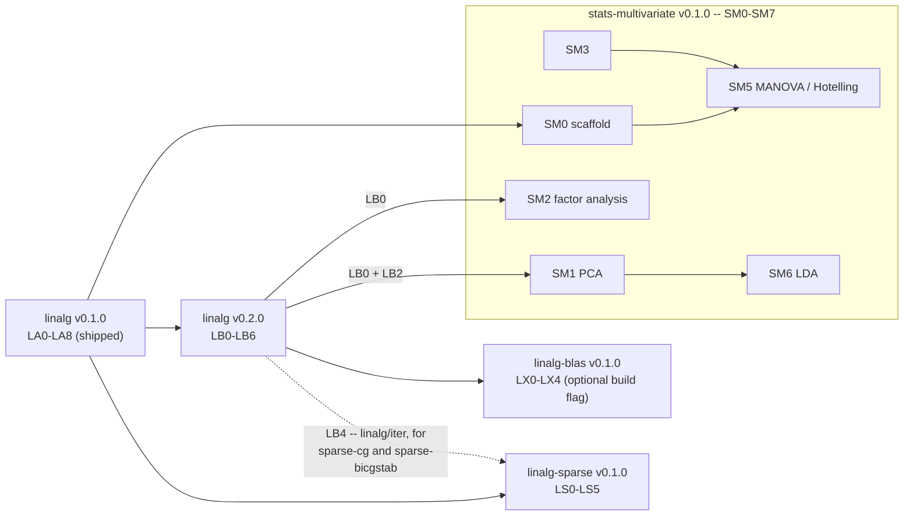

# Follow-up Plan: tur-linalg v0.2, tur-linalg-sparse, and BLAS backend

> **Status:** On hold, not started. The plan sat in `docs/upcoming/hold/`
> until the 2026-10-16 flatten. Its prerequisite, `tur-linalg` v0.1.0, has
> shipped. Checked 2026-10-18 against turmeric-spices `main`: `tur-linalg` is
> still 0.1.0, with Cholesky, LU and QR in `linalg/decomp` and none of the
> v0.2 items (SVD, eigendecomposition, iterative solvers, tiled multiply, BLAS
> backend); there is no `linalg-sparse` or `stats-multivariate` spice.
> **Last Updated:** 2026-05-27
> **Type:** Spice Follow-up
> **Depends on:** [linalg-spice-plan.md](../../archive/linalg-spice-plan.md) (v0.1.0 complete, tagged `linalg-v0.1.0`)

---

## Overview

This plan covers the four categories of future work deferred from
`linalg-spice-plan.md`:

1. **`tur-linalg` v0.2** -- SVD and eigendecomposition (unlocks `tur-stats-multivariate`)
2. **`tur-linalg` v0.2** -- Iterative solvers (conjugate gradient and BiCGSTAB)
3. **`tur-linalg` v0.2** -- Performance: BLAS-level tiling for large matrix multiply
4. **`tur-linalg-sparse`** -- New spice: CSR/CSC sparse matrix type and sparse solvers
5. **BLAS/LAPACK backend** -- Optional CMake dep behind the existing `linalg/` API

Items 1--3 are extensions to the existing `tur-linalg` spice (versioned as
v0.2). Items 4 and 5 are independent deliverables that build on the v0.1.0
foundation but live in separate scopes.

---

## Scope summary

| Deliverable | Tag | New spice? | Blocked on |
|---|---|---|---|
| SVD + eigendecomposition | `linalg-v0.2.0` | No | `linalg-v0.1.0` |
| Iterative solvers | `linalg-v0.2.0` | No | `linalg-v0.1.0` |
| Matrix multiply tiling | `linalg-v0.2.0` | No | `linalg-v0.1.0` |
| `tur-linalg-sparse` | `linalg-sparse-v0.1.0` | Yes | `linalg-v0.1.0` |
| BLAS/LAPACK backend | `linalg-blas-v0.1.0` | No (opt-in build flag) | `linalg-v0.2.0` |
| `tur-stats-multivariate` | `stats-multivariate-v0.1.0` | Yes | `linalg-v0.2.0` (SM0 earlier) |

---

## Part A: tur-linalg v0.2

### A.1 New result types

`linalg/decomp` gains two new factor structs:

```turmeric
;;; svd-factor -- result of SVD: A = U S V'.
(defstruct svd-factor
  U     :int      ;; orthogonal mat (m x m)
  s     :int      ;; vec of singular values (length min(m,n)), descending
  Vt    :int)     ;; orthogonal mat, V transposed (n x n)

;;; eigen-factor -- result of symmetric eigendecomposition: A = Q D Q'.
(defstruct eigen-factor
  vals  :int      ;; vec of eigenvalues (ascending)
  vecs  :int)     ;; mat whose columns are the corresponding eigenvectors
```

### A.2 New exports -- `linalg/decomp`

```turmeric
;; SVD -- A may be rectangular (m >= n or m < n).
(svd A)                                    ;; => svd-factor  (never fails)
(svd-free f)                               ;; => :void

;; Symmetric eigendecomposition -- A must be symmetric.
;; Computed via Jacobi iteration (converges for any symmetric A).
;; Returns err if A is not square.
(eigen-sym A)                              ;; => result<eigen-factor>
(eigen-free f)                             ;; => :void
```

### A.3 New exports -- `linalg/solve`

```turmeric
;; Least-squares / minimum-norm via SVD (rank-revealing; handles rank deficiency).
(svd-solve f b)                            ;; => vec   min ||Ax - b||, rank-truncated
(svd-rank f tol)                           ;; => :int  numerical rank at tolerance tol
(svd-condition f)                          ;; => :float  condition number (s[0]/s[k-1])

;; Project b onto the column space of A via its SVD.
(svd-project f b)                          ;; => vec
```

### A.4 New exports -- `linalg/small`

```turmeric
;; mat2 / mat3 -- added to linalg/small for completeness.
(mat2-identity)                            ;; => mat2
(mat2-mul a b)                             ;; => mat2
(mat2-inv m)                               ;; => mat2
(mat3-identity)                            ;; => mat3
(mat3-mul a b)                             ;; => mat3
(mat3-inv m)                               ;; => mat3
(mat3-normal-mat m)                        ;; => mat3  transpose(inverse(upper-left 3x3 of m))
```

### A.5 Iterative solvers -- new module `linalg/iter`

Iterative solvers complement the direct (factorization) solvers for large or
near-sparse systems where forming and factoring the full matrix is impractical.

```turmeric
;;; IterOpts -- convergence and limit controls shared by all iterative solvers.
(defstruct IterOpts
  max-iters  :int      ;; maximum iterations before declaring non-convergence
  tol        :float    ;; residual tolerance: stop when ||r||_2 < tol
  verbose    :int)     ;; 1 = print residual per iteration

;;; iter-result -- outcome of an iterative solve.
(defstruct iter-result
  x          :int      ;; vec: solution (or best iterate on non-convergence)
  iters      :int      ;; number of iterations taken
  residual   :float    ;; ||Ax - b||_2 at termination
  converged  :int)     ;; 1 if residual < tol, 0 otherwise

;; Conjugate gradient -- A must be SPD; fastest for large SPD systems.
(cg A b opts)                              ;; => iter-result
(cg-free r)                                ;; => :void

;; BiCGSTAB -- A must be square and non-singular; works for non-symmetric A.
(bicgstab A b opts)                        ;; => iter-result
(bicgstab-free r)                          ;; => :void

;; Diagonal (Jacobi) preconditioner; returns a vec of reciprocal diagonal entries.
;; Pass to the solver via a future preconditioned variant (v0.3 scope).
(jacobi-precond A)                         ;; => vec
```

### A.6 Performance: matrix multiply tiling

`mat-mul` in `linalg/mat` is rewritten as a cache-blocked (tiled) loop. The
interface is unchanged; the block size is chosen at compile time (default 64)
and can be overridden via a build-time constant in `build.tur`.

This is a pure internal change -- no new public exports. It is included in
v0.2 because the iterative solvers call `mat-mul` in their inner loops and
benefit immediately from the faster implementation.

---

## Part A phases

- [ ] **LB0** -- `svd-factor` and `eigen-factor` struct definitions in
  `linalg/decomp`; `svd` via Golub-Reinsch bidiagonalization + QR sweeps;
  `svd-free`. Intermediate tests: verify `U S V' ~= A` and `U' U ~= I` and
  `V' V ~= I` on a 4x3 matrix.

- [ ] **LB1** -- `svd-solve`, `svd-rank`, `svd-condition`, `svd-project` in
  `linalg/solve`. Tests: rank-deficient overdetermined system; condition number
  of a near-singular matrix; minimum-norm solution for under-determined system.

- [ ] **LB2** -- `eigen-sym` via Jacobi iteration in `linalg/decomp`;
  `eigen-free`. Tests: 3x3 and 5x5 known SPD matrices; verify `Q D Q' ~= A`;
  verify eigenvalues match known closed-form solutions to 10 significant figures.

- [ ] **LB3** -- `mat2` / `mat3` additions to `linalg/small`; `mat3-normal-mat`.
  Tests: round-trip inverse, normal matrix construction.

- [ ] **LB4** -- New module `linalg/iter`: `IterOpts`, `iter-result`, `cg`,
  `bicgstab`, `jacobi-precond`. Tests: 50x50 SPD system via `cg`; 20x20
  non-symmetric diagonally-dominant system via `bicgstab`; verify convergence
  within `max-iters`.

- [ ] **LB5** -- Tiled `mat-mul` in `linalg/mat`: replace the naive triple loop
  with a cache-blocked implementation (block size 64 x 64). Existing
  `mat_test.tur` must pass unchanged; add a timing smoke test that multiplies
  two 512x512 matrices and records wall time for CI comparison.

- [ ] **LB6** -- Tests pass on all CI targets; update `turmeric-spices` README
  row for `tur-linalg`; update `docs/guides/linalg-guide.md` with sections on
  SVD, eigen, and iterative solvers; `linalg-v0.2.0` tag.

---

## Part B: tur-linalg-sparse

A new spice (`spices/linalg-sparse/` in `turmeric-spices`) providing sparse
matrix types and solvers. It depends on `tur-linalg` (for dense subproblems
and shared `vec` type) but adds no new C dependencies.

### Layout

```
spices/linalg-sparse/
  build.tur
  src/linalg-sparse/
    csr.tur          -- "linalg-sparse/csr"    CSR sparse matrix type
    csc.tur          -- "linalg-sparse/csc"    CSC sparse matrix type
    ops.tur          -- "linalg-sparse/ops"    SpMV, conversion, arithmetic
    solve.tur        -- "linalg-sparse/solve"  sparse direct (incomplete LU)
    fmt.tur          -- "linalg-sparse/fmt"    sparse matrix printing
  tests/linalg-sparse/
    csr_test.tur
    csc_test.tur
    ops_test.tur
    solve_test.tur
```

### Result types

```turmeric
;;; csr-mat -- Compressed Sparse Row matrix (row-major indexed access).
(defstruct csr-mat
  rows     :int    ;; number of rows
  cols     :int    ;; number of columns
  nnz      :int    ;; number of non-zero entries
  rowptr   :int    ;; :ptr to int array of length rows+1 (row start indices)
  colidx   :int    ;; :ptr to int array of length nnz (column indices)
  vals     :int)   ;; :ptr to float64 array of length nnz

;;; csc-mat -- Compressed Sparse Column matrix (column-major indexed access).
(defstruct csc-mat
  rows     :int
  cols     :int
  nnz      :int
  colptr   :int    ;; :ptr to int array of length cols+1
  rowidx   :int    ;; :ptr to int array of length nnz
  vals     :int)   ;; :ptr to float64 array of length nnz

;;; coo-entry -- one non-zero entry; used for building sparse matrices.
(defstruct coo-entry
  r    :int
  c    :int
  v    :float)
```

### Exports -- `linalg-sparse/csr`

```turmeric
;; Construction.
(csr-from-coo rows cols entries)           ;; => csr-mat  (entries is cons list of coo-entry)
(csr-from-dense m)                         ;; => csr-mat  (drops zeros)
(csr-free m)                               ;; => :void

;; Access.
(csr-rows m)                               ;; => :int
(csr-cols m)                               ;; => :int
(csr-nnz m)                                ;; => :int
(csr-get m r c)                            ;; => :float  (O(nnz/rows) scan; 0.0 if absent)

;; Arithmetic.
(csr-spmv m v)                             ;; => vec   sparse matrix-vector product
(csr-scale m s)                            ;; => csr-mat
(csr-add a b)                              ;; => csr-mat  (same sparsity pattern required)
(csr-transpose m)                          ;; => csc-mat  (natural result of transposing CSR)
```

### Exports -- `linalg-sparse/csc`

Mirror of `csr` for column-access patterns; `csc-spmv` computes `A' v`
efficiently (column-oriented traversal).

```turmeric
(csc-from-coo rows cols entries)           ;; => csc-mat
(csc-from-dense m)                         ;; => csc-mat
(csc-free m)                               ;; => :void
(csc-spmv m v)                             ;; => vec   A'v (column traversal)
(csc-transpose m)                          ;; => csr-mat
```

### Exports -- `linalg-sparse/solve`

```turmeric
;; Incomplete LU (ILU(0)) preconditioner -- same sparsity pattern as input.
;; Returns a factor pair (L, U as csr-mat each) for use with iterative solvers.
(ilu0 m)                                   ;; => result<lu-factor>   (csr-based)

;; Sparse conjugate gradient -- A must be sparse SPD (csr-mat).
;; Uses linalg/iter cg internally; A is never converted to dense.
(sparse-cg A b opts)                       ;; => iter-result  (from linalg/iter)

;; Sparse BiCGSTAB -- A must be square non-singular csr-mat.
(sparse-bicgstab A b opts)                 ;; => iter-result
```

### Part B phases

- [ ] **LS0** -- `linalg-sparse/csr`: COO-to-CSR builder (sort by row, compute
  rowptr), `csr-free`, `csr-get`, `csr-spmv`. Tests: 5x5 tridiagonal system;
  verify SpMV against equivalent dense `mat-mul-vec`.

- [ ] **LS1** -- `linalg-sparse/csc`: `csc-from-coo`, `csc-free`, `csc-spmv`,
  `csc-transpose`. Tests: same tridiagonal; compare `csc-spmv` to `csr-spmv`
  on transpose.

- [ ] **LS2** -- `linalg-sparse/ops`: `csr-scale`, `csr-add`,
  `csr-transpose`; `csr-from-dense`, `csc-from-dense`. Tests: round-trip
  dense -> sparse -> dense; add two same-pattern matrices.

- [ ] **LS3** -- `linalg-sparse/solve`: `ilu0`, `sparse-cg`, `sparse-bicgstab`.
  Tests: 100x100 sparse SPD system generated from a 1D Laplacian stencil;
  verify convergence in under 200 iterations; residual < 1e-10.

- [ ] **LS4** -- `linalg-sparse/fmt`: `csr-print` (prints non-zero entries as
  row/col/val triples), `csr->str`. Tests: print a 3x3 sparse matrix and check
  output string.

- [ ] **LS5** -- Tests pass on all CI targets; `turmeric-spices` README row for
  `tur-linalg-sparse`; short usage guide appended to `docs/guides/linalg-guide.md`
  under a new "Sparse matrices" section; `linalg-sparse-v0.1.0` tag.

---

## Part C: BLAS/LAPACK backend

An optional build-flag extension that replaces `linalg/mat` and `linalg/decomp`
hot paths with calls to system BLAS/LAPACK while keeping the same public API.

This is intentionally the last item because:
- The pure-Turmeric v0.2 implementation must be correct and tested first; the
  BLAS backend validates against those reference results.
- Build complexity is high (system library detection, CMake `find_package`); it
  must not affect users who do not opt in.

### Design

A new CMake option `TUR_LINALG_BLAS=ON` (default `OFF`) links against
`cblas` and `lapacke` when available. When enabled, `build.tur` emits an
additional inline-C glue module that routes the following functions to their
BLAS/LAPACK equivalents:

| Turmeric function | BLAS/LAPACK equivalent |
|---|---|
| `mat-mul` | `cblas_dgemm` |
| `mat-mul-vec` | `cblas_dgemv` |
| `chol` | `LAPACKE_dpotrf` |
| `lu` | `LAPACKE_dgetrf` |
| `qr` | `LAPACKE_dgeqrf` + `LAPACKE_dorgqr` |
| `svd` | `LAPACKE_dgesdd` |
| `eigen-sym` | `LAPACKE_dsyev` |

All other functions remain pure Turmeric. The inline-C glue is compiled into a
separate object (`linalg_blas_glue.o`) that is linked only when the flag is set;
non-BLAS builds do not link against `cblas` or `lapacke` at all.

The public API is identical in both modes. Behavior should be numerically
equivalent to within floating-point rounding.

### Part C phases

- [ ] **LX0** -- CMake detection: add `FindCBLAS.cmake` and `FindLAPACKE.cmake`
  modules; wire `TUR_LINALG_BLAS` option; add CI job that builds with
  `TUR_LINALG_BLAS=ON` against OpenBLAS on Ubuntu.

- [ ] **LX1** -- Inline-C glue for `mat-mul` and `mat-mul-vec` via `cblas_dgemm`
  / `cblas_dgemv`. Tests: run existing `mat_test.tur` unmodified under the BLAS
  build; add timing test showing >2x speedup on 512x512 multiply vs. tiled
  pure-Turmeric path.

- [ ] **LX2** -- Inline-C glue for `chol`, `lu`, `qr` via LAPACKE. Tests: run
  existing `decomp_test.tur` and `solve_test.tur` unmodified; verify numerical
  results agree with pure-Turmeric path to 12 significant figures.

- [ ] **LX3** -- Inline-C glue for `svd` and `eigen-sym` via `LAPACKE_dgesdd`
  and `LAPACKE_dsyev`. Tests: same datasets as LB0 and LB2; numerical agreement
  to 12 significant figures.

- [ ] **LX4** -- Documentation: note the `TUR_LINALG_BLAS` flag in
  `docs/guides/linalg-guide.md`; add installation instructions for OpenBLAS /
  MKL as optional deps; tag `linalg-blas-v0.1.0`.

---

## Dependency graph



Sparse phases LS0--LS2 and LS4 carry no such edge -- they can proceed in
parallel with LB0--LB3.

---

## Integration notes

- **`tur-stats-multivariate`**: see Part D below. PCA and factor analysis use
  `svd` (LB0) and `eigen-sym` (LB2); scaffold SM0 can start before LB0.
- **`tur-stats`**: the `qr-solve` least-squares path (already in v0.1.0) gains
  a faster BLAS-backed `qr` when `TUR_LINALG_BLAS=ON`.
- **OpenGL / rendering spices**: no new dependency on v0.2 or sparse; the
  `linalg/small` additions (mat2/mat3) are additive and non-breaking.

---

## Part D: tur-stats-multivariate

A new spice (`spices/stats-multivariate/` in `turmeric-spices`) providing
multivariate statistical methods. It depends on `tur-linalg` (for SVD,
eigendecomposition, and linear system solvers) and `tur-stats` (for
covariance, sampling, and summary utilities already implemented there).

It does not modify `tur-stats`; it imports from it.

### Layout

```
spices/stats-multivariate/
  build.tur
  src/multivariate/
    cov.tur          -- "multivariate/cov"      covariance matrix helpers, Mahalanobis distance
    pca.tur          -- "multivariate/pca"      PCA via SVD and eigen-sym
    factor.tur       -- "multivariate/factor"   exploratory factor analysis
    regress.tur      -- "multivariate/regress"  multivariate OLS (multiple response)
    test.tur         -- "multivariate/test"     Hotelling's T², one-way MANOVA
    lda.tur          -- "multivariate/lda"      linear discriminant analysis
    fmt.tur          -- "multivariate/fmt"       pretty-printing for all result types
  tests/multivariate/
    cov_test.tur
    pca_test.tur
    factor_test.tur
    regress_test.tur
    test_test.tur
    lda_test.tur
```

### Result types

```turmeric
;;; pca-result -- output of a PCA run.
(defstruct pca-result
  loadings    :int    ;; mat: columns are principal component directions (n x k)
  scores      :int    ;; mat: row projections onto k components (m x k)
  sdev        :int    ;; vec: standard deviations of each component (length k)
  var-prop    :int    ;; vec: proportion of variance explained per component
  var-cum     :int    ;; vec: cumulative proportion
  center      :int    ;; vec: column means used to center X (length n)
  scale       :int)   ;; vec: column stdevs used to scale X, or nil if unscaled

;;; fa-result -- output of exploratory factor analysis.
(defstruct fa-result
  loadings    :int    ;; mat: factor loading matrix (n x k)
  communality :int    ;; vec: communality for each variable (length n)
  uniqueness  :int    ;; vec: uniqueness = 1 - communality (length n)
  scores      :int    ;; mat: factor scores (m x k); nil if scores not requested
  method      :cstr)  ;; "paf" or "ml" (principal axis factoring / max likelihood)

;;; mv-regress-result -- output of multivariate OLS (multiple responses).
(defstruct mv-regress-result
  coef        :int    ;; mat: coefficient matrix (p x q); p predictors, q responses
  fitted      :int    ;; mat: fitted values (m x q)
  residuals   :int    ;; mat: residuals (m x q)
  rss-mat     :int    ;; mat: residual sums-of-squares matrix (q x q)
  df-resid    :int)   ;; :int: degrees of freedom (m - p)

;;; hotelling-result -- output of Hotelling's T² test (two-sample or one-sample).
(defstruct hotelling-result
  t2          :float  ;; Hotelling T² statistic
  f-stat      :float  ;; F approximation: ((n1+n2-p-1)/p(n1+n2-2)) * T²
  df1         :int    ;; numerator df = p
  df2         :int    ;; denominator df = n1+n2-p-1
  p-value     :float) ;; two-tailed p-value from F distribution

;;; manova-result -- one-way MANOVA test.
(defstruct manova-result
  wilks       :float  ;; Wilks' lambda
  pillai      :float  ;; Pillai's trace
  f-approx    :float  ;; Rao's F approximation for Wilks' lambda
  df1         :int
  df2         :int
  p-value     :float) ;; based on F approximation

;;; lda-result -- output of linear discriminant analysis.
(defstruct lda-result
  means       :int    ;; mat: class means (k x p), k classes, p features
  pooled-cov  :int    ;; mat: pooled within-class covariance matrix (p x p)
  scalings    :int    ;; mat: discriminant axes (p x d), d = k-1
  prior       :int    ;; vec: prior probabilities per class
  class-names :int)   ;; cons list of :cstr: class label strings
```

### Exports -- `multivariate/cov`

These complement `stats/cov` (which computes pairwise covariance for a frame
column list) by working directly on `linalg/mat` values.

```turmeric
;; Covariance matrix of an m x n data matrix X (each row is an observation).
;; Returns an n x n mat. Optionally centers/scales X first.
(cov-mat X)                                ;; => mat   sample covariance (unbiased)
(cov-mat-pop X)                            ;; => mat   population covariance (biased)
(cor-mat X)                                ;; => mat   Pearson correlation matrix

;; Mahalanobis distance from each row of X to centroid mu,
;; given inverse covariance S-inv (n x n mat).
;; Returns a vec of m distances.
(mahalanobis X mu S-inv)                   ;; => vec

;; Convenience: compute S-inv from X via LU, then mahalanobis.
(mahalanobis-auto X)                       ;; => vec
```

### Exports -- `multivariate/pca`

```turmeric
;;; PCAOpts -- controls centering, scaling, and number of components retained.
(defstruct PCAOpts
  center   :int    ;; 1 = subtract column means (default 1)
  scale    :int    ;; 1 = divide by column stdevs (default 0)
  ncomp    :int)   ;; components to retain; 0 = retain all

;; Run PCA on an m x n data matrix X.
;; Uses SVD of the centered/scaled X (thin SVD via linalg/decomp svd).
(pca X opts)                               ;; => pca-result
(pca-free r)                               ;; => :void

;; Project new observations onto the fitted PCA space.
;; X-new must have the same n columns as the original X.
(pca-project r X-new)                      ;; => mat   (m-new x k scores)

;; Reconstruct approximate X from k components.
(pca-reconstruct r k)                      ;; => mat

;; Proportion of variance explained by the first k components.
(pca-var-explained r k)                    ;; => :float
```

### Exports -- `multivariate/factor`

```turmeric
;;; FAOpts -- exploratory factor analysis options.
(defstruct FAOpts
  nfactors :int    ;; number of factors to extract
  method   :cstr   ;; "paf" (principal axis factoring) or "ml" (not in v0.1)
  scores   :int    ;; 1 = compute factor scores (default 0)
  rotate   :cstr)  ;; "none" or "varimax" (v0.1: none only)

;; Fit exploratory factor model to n x n correlation matrix R.
;; Caller should compute R via cor-mat first.
(factor-analysis R opts)                   ;; => result<fa-result>
(fa-free r)                                ;; => :void
```

### Exports -- `multivariate/regress`

Multivariate OLS extends `stats/regress` to q response variables simultaneously.
It solves X B = Y in the least-squares sense via QR (from `linalg/decomp`).

```turmeric
;; Fit multivariate OLS: Y = X B + E, where Y is m x q and X is m x p.
;; X should include a column of ones for the intercept if desired.
(mv-ols X Y)                               ;; => mv-regress-result
(mv-ols-free r)                            ;; => :void

;; Predict responses for new observations X-new (m-new x p).
(mv-predict r X-new)                       ;; => mat   (m-new x q)

;; Coefficient of determination R² for each response column.
(mv-r-squared r)                           ;; => vec   (length q)
```

### Exports -- `multivariate/test`

```turmeric
;; One-sample Hotelling's T²: test that the mean of X equals mu0.
;; X is m x p; mu0 is a p-vec.
(hotelling-1samp X mu0)                    ;; => hotelling-result

;; Two-sample Hotelling's T²: test that mean(X1) == mean(X2).
;; Both matrices must have the same number of columns p.
(hotelling-2samp X1 X2)                    ;; => hotelling-result
(hotelling-free r)                         ;; => :void

;; One-way MANOVA: test that group means are equal across k groups.
;; groups is a cons list of mats, one per group.
(manova-1way groups)                       ;; => manova-result
(manova-free r)                            ;; => :void
```

### Exports -- `multivariate/lda`

```turmeric
;;; LDAOpts -- controls prior and solver choice.
(defstruct LDAOpts
  prior    :int    ;; vec of prior probabilities (nil = use class frequencies)
  tol      :float) ;; tolerance for rank check on pooled covariance

;; Fit LDA from data matrix X (m x p) and class label vector y (cons list of :int).
;; Class labels are integers 0..k-1.
(lda-fit X y opts)                         ;; => result<lda-result>
(lda-free r)                               ;; => :void

;; Predict class labels for new observations.
;; Returns a cons list of :int (predicted class per row).
(lda-predict r X-new)                      ;; => list<:int>

;; Posterior probabilities for each class (m-new x k mat).
(lda-posterior r X-new)                    ;; => mat

;; Project X onto the d discriminant axes (m x d scores).
(lda-transform r X)                        ;; => mat
```

### Exports -- `multivariate/fmt`

```turmeric
(pca-print r)                              ;; => :void  (variance table + top loadings)
(pca-print-loadings r k)                   ;; => :void  (loadings for first k components)
(fa-print r)                               ;; => :void  (loading matrix + communalities)
(mv-regress-print r)                       ;; => :void  (coefficient table)
(hotelling-print r)                        ;; => :void  (T², F, df, p-value)
(manova-print r)                           ;; => :void  (Wilks', Pillai, F, p-value)
(lda-print r)                              ;; => :void  (class means + discriminant axes)
```

### Part D phases

- [ ] **SM0** -- `build.tur`; spice deps on `tur-linalg` (v0.1.0) and
  `tur-stats`; `multivariate/cov`: `cov-mat`, `cov-mat-pop`, `cor-mat`,
  `mahalanobis`, `mahalanobis-auto`. Tests: 4x3 toy dataset; verify
  `cov-mat` matches the `stats/cov` pairwise result; verify
  Mahalanobis distance from center equals zero.
  *Unblocked: can start once `linalg-v0.1.0` is tagged.*

- [ ] **SM1** -- `multivariate/pca`: `PCAOpts`, `pca`, `pca-project`,
  `pca-reconstruct`, `pca-var-explained`, `pca-free`. Algorithm: center/scale
  X; thin SVD via `linalg/decomp svd`; loadings = V columns, scores = U * S.
  Tests: iris-style 4-column dataset; verify `loadings' * loadings ~= I`;
  verify cumulative variance reaches 1.0; round-trip `pca-reconstruct` with
  all components recovers X to tolerance.
  *Blocked on LB0 (SVD).*

- [ ] **SM2** -- `multivariate/factor`: `FAOpts`, `factor-analysis` via
  principal axis factoring (iterated principal components with communality
  updates); `fa-free`. Varimax rotation is out of scope for v0.1.
  Tests: 6-variable correlation matrix with known 2-factor structure; verify
  communality + uniqueness = 1.0 per variable; loadings reproduce input R
  within tolerance.
  *Blocked on LB0 (SVD) and SM0.*

- [ ] **SM3** -- `multivariate/regress`: `mv-ols`, `mv-predict`,
  `mv-r-squared`, `mv-ols-free`. Solver: QR decomposition of X via
  `linalg/decomp qr`, then `qr-solve` applied column-wise to Y.
  Tests: 2-response system with known analytical solution; verify coefficient
  matrix matches; verify `mv-r-squared` matches column-wise `stats/regress`
  R² values.
  *Blocked on SM0.*

- [ ] **SM4** -- `multivariate/test`: `hotelling-1samp`, `hotelling-2samp`,
  `manova-1way`, and their free functions. F and p-value computation delegate
  to `stats/dist` for the F-distribution CDF.
  Tests: one-sample T² against a known mean (verify p-value matches R's
  `HotellingsT2Test`); two-sample test on groups known to differ; one-way
  MANOVA on three groups.
  *Blocked on SM0.*

- [ ] **SM5** -- `multivariate/lda`: `LDAOpts`, `lda-fit`, `lda-predict`,
  `lda-posterior`, `lda-transform`, `lda-free`. Algorithm: pooled within-class
  covariance via `multivariate/cov`; between-class scatter; generalized
  eigendecomposition via `eigen-sym` on S_w^{-1} S_b.
  Tests: 2-class 2D dataset with known linear boundary; verify `lda-predict`
  classification accuracy > 95%; verify discriminant axis is orthogonal.
  *Blocked on SM0, SM3, and LB2 (eigen-sym).*

- [ ] **SM6** -- `multivariate/fmt`: all print functions. Tests: verify
  `pca-print` and `fa-print` produce non-empty output without crashing on
  minimal datasets; variance table rows sum to 1.0.
  *Blocked on SM1--SM5.*

- [ ] **SM7** -- Tests pass on all CI targets; `turmeric-spices` README row
  for `tur-stats-multivariate`; `docs/guides/multivariate-guide.md` with
  sections on PCA, factor analysis, multivariate regression, Hotelling's T²,
  and LDA; `stats-multivariate-v0.1.0` tag.
  *Blocked on SM0--SM6.*

### Out of scope for v0.1.0

| Future work | What it adds |
|---|---|
| `v0.2` | Varimax / oblimin rotation for factor analysis |
| `v0.2` | Maximum-likelihood factor analysis |
| `v0.2` | Canonical Correlation Analysis (CCA) |
| `v0.2` | Quadratic Discriminant Analysis (QDA) |
| `v0.3` | k-means and hierarchical clustering |
| `v0.3` | Multidimensional scaling (MDS / UMAP is out of scope) |
| `v0.3` | Structural Equation Modeling (SEM) basics |

---

1. **SVD algorithm choice.** Golub-Reinsch (one-sided bidiagonalization +
   iterative QR sweeps) is the standard textbook choice. For very rectangular
   matrices (m >> n) a Lanczos-based approach is faster but more complex.
   v0.2 will use Golub-Reinsch and document the limitation; a Lanczos path can
   be added in v0.3.

2. **Sparse solver scope.** ILU(0) as a preconditioner is included in LS3, but
   a direct sparse Cholesky (e.g. supernodal elimination) is not. If
   `tur-stats-multivariate` or other consumers need a direct sparse solver,
   revisit before the `linalg-sparse-v0.2.0` planning cycle.

3. **BLAS detection portability.** `cblas.h` and `lapacke.h` headers are
   available via OpenBLAS, MKL, and Apple Accelerate but are placed in
   different include paths on each platform. LX0 must handle at least
   Linux/OpenBLAS and macOS/Accelerate; Windows/OpenBLAS can follow in a
   separate patch.

4. **Sparse + BLAS interaction.** The BLAS backend only accelerates dense
   operations. `tur-linalg-sparse` always uses the pure-Turmeric path.
   A future `TUR_LINALG_SPARSE_MKL` flag could route `sparse-cg` to MKL
   sparse BLAS, but that is out of scope for v0.1.

5. **F-distribution CDF in tur-stats.** Hotelling's T² and MANOVA p-values
   require the F-distribution CDF. `stats/dist` provides `f-cdf` in the
   existing `tur-stats` v0.1.0 spice; SM4 should verify this function's
   accuracy against tabulated F critical values before depending on it for
   p-value computation.

6. **Generalized eigendecomposition for LDA.** LDA requires solving
   `S_w^{-1} S_b v = λ v`. The plan routes this through `mat-inv` (LU) + `eigen-sym`
   on the product. For numerically ill-conditioned pooled covariance matrices
   a regularized LDA (ridge shrinkage on `S_w`) may be needed; SM5 should
   add a `tol` parameter in `LDAOpts` to trigger the regularized path when
   `S_w` is near-singular.
