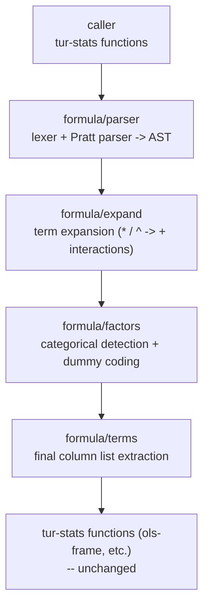

# Plan: Wilkinson-Style Formula DSL for tur-stats

> **Status:** Implemented 2026-10-29: SF0-SF8 done and SF9's docs done, in
> turmeric-spices `spices/stats-formula` (branch `claude/stats-formula`).
> Left: merge, then the `stats-formula-v0.1.0` tag, then archive this plan.
> What changed from the design below is in "Outcome", at the end.
> **Last Updated:** 2026-10-29
> **Type:** Spice Design
> **Spice Location:** `turmeric-spices/spices/stats-formula`

---

## Overview

This plan describes the implementation of `tur-stats-formula`, a spice that
provides a Wilkinson-style formula DSL for Turmeric, enabling R-like model
specification syntax such as:

```clojure
y ~ x1 * x2 + I(x3^2)
```

The formula parser expands this compact syntax into explicit column lists that
can be passed directly to existing `tur-stats` functions like `ols-frame`,
`t-test-2samp` (with formula support), and other model-fitting routines.

Currently, `tur-stats` v0.1.0 takes predictor and response columns directly
as explicit lists. This spice adds the formula layer on top, returning the same
column lists that the underlying functions expect, making it a non-breaking
addition to the ecosystem.

---

## Background: Wilkinson-Rogers Formulas

Wilkinson and Rogers (1973) introduced a concise syntax for specifying
statistical models, later popularized by R and S. The grammar supports:

- **Response and predictors:** `y ~ x1 + x2`
- **Interactions:** `y ~ x1 * x2` (expands to `x1 + x2 + x1:x2`)
- **Nested terms:** `y ~ x1 / x2` (expands to `x1 + x1:x2`)
- **Power terms:** `y ~ x1^2` (includes all interactions up to order 2)
- **Identity wrapper:** `I(x^2)` for arbitrary expressions (literal, not symbolic)
- **Factor expansion:** `y ~ A` where A is categorical → dummy variables
- **Intercept control:** `y ~ x1 + x2 + 0` (no intercept) or `y ~ x1 + x2 - 1`

The formula `y ~ x1 * x2 + I(x3^2)` expands to response `y` with predictors:
`x1, x2, x1:x2, x3^2` (where `x3^2` is computed as a new column).

---

## Scope

### In scope for v0.1.0

- **Core parser:** Lexer and Pratt parser for Wilkinson formula syntax
- **Term expansion:** Algorithmic expansion of `*`, `/`, `^` operators
- **Identity terms:** `I(...)` for literal expressions (arithmetic, powers, etc.)
- **Factor detection:** Identify categorical vs. numeric columns in a frame
- **Dummy coding:** Convert categorical factors to dummy/indicator variables
- **Intercept control:** Support `+0` / `-1` to suppress intercept, default to include
- **Integration:** `formula->terms` function returning `{:response col :predictors [col1 col2 ...] :intercept? bool}`

### Out of scope for v0.1.0

| Future enhancement | Description |
|--------------------|-------------|
| `offset()` | Model offset terms |
| `strata()` | Stratification for stratified models |
| `weights()` | Case weights |
| `subset()` | Row subsetting |
| `transform()` | Transformations like `log`, `sqrt` in formulas |
| `poly()` | Polynomial regression via orthogonal polynomials |
| `splines` | Natural cubic splines, bsplines |
| `ns()` | Natural splines |
| `factor()` | Explicit factor declaration |

---

## Architecture



All formula processing is **pure Turmeric** with inline-C only for performance
critical paths (none anticipated for v0.1.0). The spice depends only on
`tur-frame` for column access and type introspection.

---

## Spice Layout

```
turmeric-spices/spices/stats-formula/
  build.tur
  README.md
  src/formula/
    lexer.tur       -- token lexer for formula strings
    parser.tur      -- Pratt parser for operator precedence
    ast.tur         -- AST node types and constructors
    expand.tur      -- term expansion algorithms (* / ^)
    factors.tur     -- categorical detection and dummy coding
    terms.tur       -- top-level formula->terms interface
    identity.tur    -- I() expression evaluation
  tests/formula/
    lexer_test.tur
    parser_test.tur
    expand_test.tur
    factors_test.tur
    terms_test.tur
    identity_test.tur
```

---

## Result Types

As shipped (the original sketch typed every handle, list and flag `:int`):

```turmeric
;;; FormulaTerms -- a formula fitted to a frame (formula/terms).
(defstruct ^copy FormulaTerms
  [response   : cstr        ;; the response's column name in `data` ("mpg", "log(mpg)")
   predictors : (Cons cstr) ;; model-matrix column names in `data`, in order
   intercept  : bool
   terms      : (Cons Term) ;; the expanded terms ("wt", "wt:hp")
   data       : ModelFrame  ;; response + predictor columns, float64, complete rows
   dropped    : int])       ;; incomplete rows left out

;;; ModelFrame -- a tur-frame frame this spice built; the caller frees it
;;; (formula/model-frame). model-frame-handle unwraps it for frame/* and stats/*.
(defopaque ModelFrame :int)

;;; FormulaError -- kind (a FormulaErrorKind), message, and a byte position
;;; for syntax errors (formula-error-pos : (Option int)).
```

An `I()` term is not a separate result: it is a column of the model frame,
and `formula-eval-identity` returns a one-column `ModelFrame`.

---

## Modules and Exports

### formula/ast

AST node types for formula terms:

```turmeric
(defenum FormulaNodeTag
  FORM_RESPONSE   ;; LHS of ~
  FORM_PREDICTOR  ;; atomic predictor (column name)
  FORM_SUM        ;; A + B (list of terms)
  FORM_INTERACT   ;; A * B (interaction)
  FORM_NEST       ;; A / B (nested)
  FORM_POWER      ;; A ^ n (all interactions up to order n)
  FORM_IDENTITY   ;; I(expr)
  FORM_INTERCEPT  ;; +0 or -1 marker
)

(defstruct FormulaNode
  tag       :int    ;; FormulaNodeTag
  name      :cstr   ;; for FORM_PREDICTOR / FORM_RESPONSE: column name
  left      :int    ;; for binary ops: left child node
  right     :int    ;; for binary ops: right child node
  power     :int    ;; for FORM_POWER: the exponent n
  expr      :cstr)  ;; for FORM_IDENTITY: the expression string
```

### formula/lexer

Token types and lexer:

```turmeric
(defenum FormulaToken
  TOK_NAME       ;; column name / reserved word
  TOK_TILDE      ;; ~
  TOK_PLUS       ;; +
  TOK_STAR       ;; *
  TOK_SLASH      ;; /
  TOK_CARET      ;; ^
  TOK_LPAREN     ;; (
  TOK_RPAREN     ;; )
  TOK_COMMA      ;; ,
  TOK_NUMBER     ;; numeric literal
  TOK_I          ;; I (identity)
  TOK_0          ;; 0 (intercept suppress)
  TOK_1          ;; 1 (intercept force - redundant but allowed)
  TOK_EOF        ;; end of input
)

(defstruct Token
  type   :int    ;; FormulaToken
  text   :cstr   ;; token text
  pos    :int)   ;; character position in input (for error reporting)

;;; formula-lex -- tokenize a formula string.
;;; Returns a cons list of Token. Caller must free with token-list-free.
(formula-lex input)  ;; => list<Token>
```

### formula/parser

Pratt parser for operator precedence. The grammar is:

```
formula   ::= response '~' rhs
response  ::= term
rhs       ::= term (('+' | '-' | '*' | '/' | '^') term)*
term       ::= NAME
            | 'I(' expression ')'
            | '(' rhs ')'
expression ::= ... (arithmetic expression for I())
```

Operator precedence (highest to lowest):
1. `^` (power) - right associative
2. `*` (interaction), `/` (nesting)
3. `+` (sum), `-` (remove)

```turmeric
;; Parse a full formula string into an AST.
;; Returns FormulaNode* (root) or NULL on error.
;; Sets *err_msg if non-NULL.
(formula-parse input tokens)  ;; => FormulaNode*

;; Convenience: parse from string, return formula-terms directly.
(formula-parse-terms f formula-str)  ;; => formula-terms or error
```

### formula/expand

Term expansion transforms the parsed AST into a flat list of terms:

- `A * B` → `A + B + A:B`
- `A / B` → `A + A:B`
- `A * B * C` → `A + B + C + A:B + A:C + B:C + A:B:C`
- `A ^ 2` → `A + A:A` (all interactions up to order 2)
- `A ^ 3` → `A + A:A + A:A:A` (all interactions up to order 3)
- `A + B - 1` → `A + B` with intercept suppressed

Interaction terms are represented as column name strings with `:` separator.
These are later resolved to actual column handles or computed via `I()`.

```turmeric
;; Expand a parsed AST into a list of term strings.
;; Each term is either a column name or an interaction like "a:b".
(formula-expand node)  ;; => list<:cstr>

;; Expand and resolve terms against a frame.
;; Returns list of column handles + any computed columns from I().
(formula-expand-terms node f)  ;; => list<:int>
```

### formula/factors

Categorical column handling and dummy coding:

```turmeric
;; Check if a column in frame f is categorical (factor).
;; Uses tur-frame's type system: string or enum columns are categorical.
(formula-is-factor f col-name)  ;; => :int (1 if categorical, 0 otherwise)

;; Get the levels of a categorical column.
;; Returns cons list of distinct values.
(formula-factor-levels f col)  ;; => list<:cstr>

;; Create dummy variables for a categorical column.
;; base-level = the level to omit (default: first level for intercept models,
;;              or explicit with :base parameter).
;; Returns a frame with new columns for each dummy.
(formula-dummy-code f col-name base-level)  ;; => frame

;; Create dummy variables for all interaction terms.
;; "a:b" where a is categorical and b is numeric: treat a as factor levels.
;; "a:b" where both are categorical: create all combinations.
(formula-dummy-code-interaction f a-name b-name)  ;; => frame
```

### formula/identity

`I()` expression evaluation for literal terms:

```turmeric
;; Evaluate an identity expression against a frame.
;; expr is a string like "x^2", "x * y", "log(z)".
;; Returns a new column handle (caller owns).
(formula-eval-identity f expr)  ;; => :int (column handle)

;; Supported operations in I():
;; - arithmetic: +, -, *, /, ^
;; - math functions: log, exp, sqrt, abs (delegates to tur-math)
;; - column references: x, y, z (looked up in frame)
```

### formula/terms (Top-Level Interface)

```turmeric
;;; Main entry point: parse a formula string and extract terms.
;;;
;;; Parameters:
;;;   f          -- tur-frame handle
;;;   formula-str -- string like "y ~ x1 * x2 + I(x3^2)"
;;;
;;; Returns:
;;;   formula-terms struct with response, predictors list, intercept flag.
;;;   Any computed columns from I() are added to f (caller can access them).
;;;
;;; Example:
;;;   (let [f (read-csv "data.csv")
;;;         terms (formula-parse-terms f "mpg ~ wt * hp + I(wt^2)")]
;;;     (ols-frame f (formula-terms-response-name terms)
;;;                (formula-terms-predictor-names terms)
;;;                1))
(formula-parse-terms f formula-str)  ;; => formula-terms

;;; Shorthand: extract just the predictor column names as a list.
(formula-predictors f formula-str)  ;; => list<:cstr>

;;; Shorthand: extract response column name.
(formula-response f formula-str)  ;; => :cstr

;;; Check if formula includes intercept (default yes, unless +0 or -1).
(formula-intercept? f formula-str)  ;; => :int
```

---

## Integration with tur-stats

The `tur-stats-formula` spice is designed to be **composable** with existing
`tur-stats` functions. No changes to `tur-stats` are required; callers simply
use the formula parser to obtain column lists and pass them to existing functions.

### Usage Examples

```turmeric
(import formula/terms :refer [formula-parse-terms])
(import stats/regress :refer [ols-frame])

;; Simple linear model
(let [f     (read-csv "mtcars.csv")
      terms (formula-parse-terms f "mpg ~ wt + hp")]
  (ols-frame f (formula-terms-response terms)
             (formula-terms-predictors terms)
             (formula-terms-intercept? terms)))

;; With interactions
(let [terms (formula-parse-terms f "mpg ~ wt * hp")]
  (ols-frame f ...))

;; With identity term
(let [terms (formula-parse-terms f "mpg ~ wt + I(hp^2)")]
  (ols-frame f ...))

;; Without intercept
(let [terms (formula-parse-terms f "mpg ~ wt + hp - 1")]
  (ols-frame f ...))

;; Categorical predictor with automatic dummy coding
(let [terms (formula-parse-terms f "mpg ~ cyl")]  ;; cyl is categorical
  (ols-frame f ...))  ;; internally creates dummy columns
```

### Extended tur-stats Functions (Optional Future Enhancement)

In a future version, `tur-stats` functions could gain native formula support:

```turmeric
;; Hypothetical future API - not part of v0.1.0
(ols-frame-formula f "mpg ~ wt * hp")
(t-test-formula f "mpg ~ am")  ;; am is binary categorical
```

But v0.1.0 keeps the formula layer separate to avoid coupling.

---

## Implementation Phases

- [x] **SF0** -- `build.tur`; spice deps on `tur-frame`; `formula/ast` with
  node types and constructors; basic AST manipulation.

- [x] **SF1** -- `formula/lexer`: token lexer for formula syntax; handles
  names, operators (`~ + * / ^`), parentheses, `I()`, numeric literals;
  position tracking for error messages.

- [x] **SF2** -- `formula/parser`: Pratt parser implementing operator
  precedence; builds AST from token stream; error recovery and
  meaningful error messages.

- [x] **SF3** -- `formula/expand`: term expansion algorithms; expands `*`
  (interaction), `/` (nesting), `^` (power/poly) into flat `+` term lists;
  handles `+0` and `-1` for intercept control.

- [x] **SF4** -- `formula/factors`: categorical column detection via
  `tur-frame` type introspection; `formula-is-factor`; `formula-factor-levels`;
  basic dummy coding for single factors.

- [x] **SF5** -- `formula/identity`: `I()` expression parser and evaluator;
  supports arithmetic operators and math functions; delegates to `tur-math`
  for `log`, `exp`, `sqrt`, etc.; creates computed columns.

- [x] **SF6** -- `formula/terms`: top-level interface; `formula-parse-terms`
  orchestrates lexing, parsing, expansion, factor detection, identity
  evaluation; returns `formula-terms` struct; handles frame lifecycle
  for computed columns.

- [x] **SF7** -- **Interaction terms**: support for `a:b` interaction
  terms in dummy coding; `formula-dummy-code-interaction` creates product
  columns for categorical-by-categorical and categorical-by-numeric
  interactions.

- [x] **SF8** -- **Tests and validation**: comprehensive test suite
  covering formula parsing edge cases, expansion correctness, factor
  handling, identity expressions; validate against R's `model.frame`
  behavior on representative formulas.

- [x] **SF9** -- **Documentation and release**: README in spice repo;
  `docs/guides/formula-guide.md`; `stats-formula-v0.1.0` tag.

---

## Design Notes

### Why a Separate Spice?

The formula DSL is a **syntactic convenience** layer, not a statistical
computation layer. By keeping it separate from `tur-stats`:

1. Users who don't need formula syntax avoid the dependency
2. The formula spice can evolve independently (e.g., adding `poly()`, `splines`)
3. Multiple statistical spices can share the same formula parser
4. `tur-stats` remains focused on computation, not parsing

### Pratt Parser vs. Recursive Descent

The Pratt parsing algorithm ("Top-Down Operator Precedence Parsing") is ideal
for formula DSLs because:

- Handles operator precedence naturally
- Supports both left- and right-associative operators
- Minimal code size (~100 lines)
- Easy to extend with new operators
- Standard technique for expression parsers

### Interaction Term Representation

Interaction terms like `a:b` are represented as **string concatenation** with
`:` in the expansion phase, then resolved to actual columns:

- If both `a` and `b` are numeric: create a new column `a * b`
- If `a` is categorical and `b` is numeric: create `a_level * b` for each level
- If both are categorical: create columns for each combination of levels

This follows R's semantics for `model.matrix()`.

### Dummy Coding Strategy

For categorical predictors, we use **treatment contrasts** (R's default):

- One level is the **base level** (omitted from the model matrix)
- Each other level gets a binary column (1 if observation has that level, 0 otherwise)
- With intercept: base level is implicit in the intercept term
- Without intercept: all levels get columns (no omissions)

The base level defaults to the first level alphabetically, but can be
specified explicitly.

### Identity Expression Evaluation

`I()` expressions are evaluated as **literal arithmetic**, not symbolic:

- `I(x^2)` → compute `x * x` as a new column
- `I(x + y)` → compute element-wise sum
- `I(log(x))` → compute natural log of each element

This is different from the symbolic interaction syntax (`a:b`), which creates
structural model terms.

### Error Handling

The parser provides **clear, actionable error messages**:

- `"Unexpected token ')' at position 12"`
- `"Column 'xyz' not found in frame"`
- `"Identity expression 'log(x)' failed: domain error at row 5"`
- `"Interaction 'a:b' requires both columns to be present"`

### Memory Management

Ownership rules:

- AST nodes returned by parser: **caller owns**, must call `formula-ast-free`
- Token lists: **caller owns**, must call `token-list-free`
- Computed columns from `I()`: **added to input frame**, freed when frame is freed
- `formula-terms` struct: **caller owns**, but column handles are borrowed from frame

---

## Risks and Open Questions

1. **Formula syntax variations.** R supports many edge cases (`y ~ .` for
   all predictors except response, `y ~ -1 + x` for no intercept, etc.).
   v0.1.0 implements the core 80% of use cases; edge cases are future work.

2. **Performance of dummy coding.** For categorical columns with many levels
   (e.g., 1000+), dummy coding creates many columns. v0.1.0 does this eagerly;
   a future optimization could use sparse representations.

3. **Name collisions.** If `I(x^2)` creates a column and the frame already has
   a column named `x^2`, we need a strategy. Options: error, or auto-rename
   with a numeric suffix. v0.1.0 will error and require explicit renaming.

4. **Math function namespace.** `I(sin(x))` requires access to math functions.
   We delegate to `tur-math` where available. Functions not in `tur-math`
   (like `log10`, `gamma`) are out of scope for v0.1.0.

5. **Missing values.** How to handle NA in categorical columns during dummy
   coding? R creates a `NA` level or drops rows. v0.1.0 will follow R's
   `na.action = na.omit` default (drop rows with NA in factors).

6. **Character encoding.** Formula strings may contain non-ASCII column names.
   v0.1.0 assumes UTF-8 and delegates to `tur-frame`'s column name handling.

---

## Shared Work

### turmeric-spices README

Add row once v0.1.0 is tagged:

| Spice | Description | Tier | Depends on |
|-------|-------------|------|------------|
| `tur-stats-formula` | Wilkinson-style formula DSL for model specification | 1 -- pure Turmeric | `tur-frame` |

### Guide

Deliver `docs/guides/formula-guide.md` alongside the `v0.1.0` tag. Sections:

1. Formula syntax overview (`~`, `+`, `*`, `/`, `^`, `I()`)
2. Simple models: `y ~ x1 + x2`
3. Interactions: `y ~ x1 * x2` vs `y ~ x1:x2`
4. Factor variables and dummy coding
5. Identity terms for transformations
6. Intercept control
7. Integration with tur-stats functions
8. Comparison with R formula syntax

### Coordination with tur-stats

While `tur-stats-formula` is independent, we should coordinate with the
`tur-stats` maintainers on:

- Column naming conventions for interaction terms
- Error message formats
- Whether future `tur-stats` functions will accept formulas directly

---

## Files to Change

| File | Change |
|------|--------|
| `turmeric-spices/spices/stats-formula/build.tur` | New spice definition |
| `turmeric-spices/spices/stats-formula/src/formula/ast.tur` | New - AST types |
| `turmeric-spices/spices/stats-formula/src/formula/lexer.tur` | New - token lexer |
| `turmeric-spices/spices/stats-formula/src/formula/parser.tur` | New - Pratt parser |
| `turmeric-spices/spices/stats-formula/src/formula/expand.tur` | New - term expansion |
| `turmeric-spices/spices/stats-formula/src/formula/factors.tur` | New - categorical handling |
| `turmeric-spices/spices/stats-formula/src/formula/identity.tur` | New - I() evaluation |
| `turmeric-spices/spices/stats-formula/src/formula/terms.tur` | New - top-level interface |
| `turmeric-spices/spices/stats-formula/tests/formula/*` | New - test suite |
| `turmeric-spices/README.md` | Add spice entry |
| `turmeric-spices/docs/guides/formula-guide.md` | New - user guide (spice guides live in the spices repo; see spices-guide-coverage-plan) |
| `docs/upcoming/spices/stats-formula-plan.md` | This document (status updates) |

---

## Phase Status

| Phase | Title | Status |
|-------|-------|--------|
| SF0 | AST types and build setup | Done |
| SF1 | Lexer | Done |
| SF2 | Pratt parser | Done |
| SF3 | Term expansion | Done |
| SF4 | Factor detection | Done |
| SF5 | Identity evaluation | Done |
| SF6 | Top-level interface | Done |
| SF7 | Interaction terms | Done |
| SF8 | Tests and validation | Done |
| SF9 | Documentation and release | Docs done; tag after merge |

---

## Outcome (2026-10-29)

Shipped as planned: the lexer, Pratt parser, expansion of `+ - * / ^ :`,
intercept control, `I()`, factor detection, treatment contrasts,
interactions with factors, `formula-parse-terms` and the shorthands, and a
test suite of ~150 cases (`spices/stats-formula/tests/formula/`, one file per
module). SF8's validation is against R itself: term labels against
`terms()`, column names against `model.matrix()`, and seven `lm()` fits on
mtcars and iris through `ols-frame`, to 1e-6.

Changed from the design above:

- **`A ^ 2` is `A`, not `A + A:A`.** In R a variable crossed with itself is
  itself, so `x^2` in a formula is `x` and `(a + b)^2` is `a + b + a:b`. The
  spice follows R; a squared column is `I(x^2)`.
- **A new model frame, not columns added to the input.** tur-frame frames are
  immutable (`with-col` returns a new one), so `formula-parse-terms` builds a
  model frame -- the response, then every model-matrix column, all float64,
  over the complete rows -- which the caller frees. Risk 3 (a computed column
  clashing with an input column) goes away; two *model* columns with one name
  (`g` with level `b` beside a column `gb`) is a `NameCollision` error.
- **Factor coding is R's model.matrix rule**, not only "drop the base level":
  contrasts when the term without the factor is empty or earlier in the
  model, every level otherwise, and with no intercept the first factor gets
  every level. That is what makes `y ~ g:x` and `y ~ x + g:x` come out as R's.
- **What is a factor:** a utf8 column. bool is numeric 0 / 1 (R: `xTRUE`).
  Levels sort by byte order. A one-level factor is `TooFewLevels`.
- **Functions:** `I`, `log`, `exp`, `sqrt`, `abs`, from stdlib/math.tur (not
  the tur-math spice). They work bare too -- `log(x)` is a variable, as in R
  -- and on the left of `~`.
- **A non-finite computed value is an error** naming the row (risk 5's
  na.omit still applies to nulls). R would carry NaN and drop the row with a
  warning.
- **Backticked names** for non-syntactic columns (`` `fuel economy` ``).
- `formula-response`, `formula-intercept?` and the added
  `formula-term-labels` take only the formula text: they need no frame.
- The AST, tokens and terms are `^heap` defdatas (freed by a region, not by
  `formula-ast-free` / `token-list-free`).
- tur-stats is an optional dependency, for the tests only.

Not done: `y ~ .` (a syntax error that says so), and everything in the
"Out of scope" table.

Turmeric bugs found on the way, each worked around in the spice and filed
(the spice README says where):
[closure-with-adt-param-rejected-by-generic-fn-param](../../reported/closure-with-adt-param-rejected-by-generic-fn-param.md),
[stdlib-cstr-import-breaks-spice-library-build](../../reported/stdlib-cstr-import-breaks-spice-library-build.md),
[list-typed-load-collides-with-frame-ownstr-string](../../reported/list-typed-load-collides-with-frame-ownstr-string.md),
and a one-module repro added to
[monomorph-emitted-before-its-type-argument](../../reported/monomorph-emitted-before-its-type-argument.md).
Fitting through tur-stats also showed its p-values are computed wrongly:
[stats-ols-pvalues-wrong-continued-fraction](../../reported/stats-ols-pvalues-wrong-continued-fraction.md).
